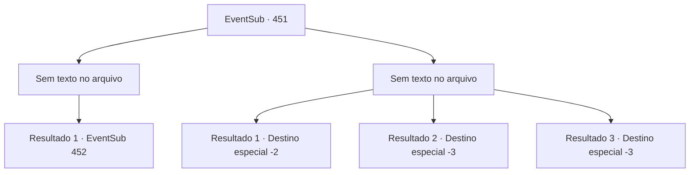

# Eventos secundários · 451

[Índice da tabela](index.md) · [Índice geral](../index.md)

ID: `pt:EventSub:451` · Fonte: `EventSub4` · Versão: 1.2.47.

Mapeamento estático dos arquivos; a disponibilidade e a execução dependem do estado da run.

## Texto do evento

*Sem texto no arquivo.*

## Dados de entrada

```json
{
  "id": 451,
  "grade": 1,
  "subEvent": "",
  "required": ""
}
```

## Mapa das escolhas



## Escolhas e resultados

### Escolha 1

*Sem texto no arquivo; o papel dessa opção depende da interface do jogo.*

Requisitos e outros campos da escolha:

```json
{
  "required": ""
}
```

#### Resultado 1.1

Você derruba o guarda e corta as cordas amarradas ao redor dos corpos. Você carrega os quatro cadáveres em uma carroça, que estava próxima, e retorna para Lorutu. 

 "Muito obrigado! Pelo menos agora posso realizar um funeral para eles..!"

 Ele se curva tão baixo que sua pequena cabeça toca o chão.

Continuação registrada: [Evento 452](0452.md) na mesma tabela.

```json
{
  "required": "",
  "chance": "1",
  "nextEvent": 452,
  "type": 2,
  "reward": ""
}
```

### Escolha 2

*Sem texto no arquivo; o papel dessa opção depende da interface do jogo.*

Requisitos e outros campos da escolha:

```json
{
  "required": ""
}
```

#### Resultado 2.1

A lança do guarda rasga sua carne. Pouco depois, mais soldados começam a correr para dentro. Você não tem escolha a não ser cobrir suas feridas e fugir.

Continuação registrada: [Destino especial `-2`](../destinos-especiais.md).

```json
{
  "required": "1_0_2|1_1_2",
  "chance": "1",
  "nextEvent": -2,
  "type": 2,
  "reward": "12_8_-1|14_8_1|0_0_-1|0_1_-1"
}
```

#### Resultado 2.2

A lança do guarda rasga sua carne. Pouco depois, mais soldados começam a correr. Você tenta correr, mas suas pernas não se movem. Ao perder o equilíbrio, você desaba.

Continuação registrada: [Destino especial `-3`](../destinos-especiais.md).

```json
{
  "required": "2_0_2",
  "chance": "1",
  "nextEvent": -3,
  "type": 2,
  "reward": "0_0_-1|0_1_-1"
}
```

#### Resultado 2.3

A lança do guarda rasga sua carne. Pouco depois, mais soldados começam a correr. Você tenta correr, mas suas pernas não se movem. Ao perder o equilíbrio, você desaba.

Continuação registrada: [Destino especial `-3`](../destinos-especiais.md).

```json
{
  "required": "2_1_2",
  "chance": "1",
  "nextEvent": -3,
  "type": 2,
  "reward": "0_0_-1|0_1_-1"
}
```

## Referências que chegam a este evento

- [Evento 450 · escolha 1 · resultado 3](0450.md#escolha-1)
- [Evento 450 · escolha 2 · resultado 1](0450.md#escolha-2)
- [Evento 450 · escolha 2 · resultado 2](0450.md#escolha-2)
- [Evento 450 · escolha 3 · resultado 1](0450.md#escolha-3)
