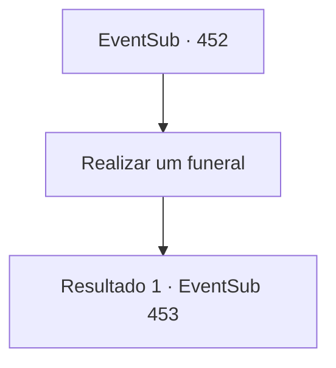

# Eventos secundários · 452

[Índice da tabela](index.md) · [Índice geral](../index.md)

ID: `pt:EventSub:452` · Fonte: `EventSub4` · Versão: 1.2.47.

Mapeamento estático dos arquivos; a disponibilidade e a execução dependem do estado da run.

## Texto do evento

*Sem texto no arquivo.*

## Dados de entrada

```json
{
  "id": 452,
  "grade": 1,
  "subEvent": "",
  "required": ""
}
```

## Mapa das escolhas



## Escolhas e resultados

### Escolha 1

Realizar um funeral

Requisitos e outros campos da escolha:

```json
{
  "required": ""
}
```

#### Resultado 1.1

Você e Lorutu recolhem galhos e pedras. Então vocês constroem um pequeno túmulo de pedra para os quatro druidas. O menino acende uma pequena vela e faz uma oração na língua dos druidas. Você não conhece a língua, mas de alguma forma entende o espírito da oração. Depois de rezar, Lorutu se levanta e enxuga suas lágrimas. 

 "Obrigado por me ajudar! Eu não vou esquecer disso!!"

 Ele procura em seus bolsos, desejando lhe dar algo. Ele tira um cogumelo, brilhando em vermelho, e lhe entrega. 

 "Isso... é para você."


Continuação registrada: [Evento 453](0453.md) na mesma tabela.

```json
{
  "required": "",
  "chance": "1",
  "nextEvent": 453,
  "type": 2,
  "reward": "12_8_-1"
}
```

## Referências que chegam a este evento

- [Evento 450 · escolha 1 · resultado 1](0450.md#escolha-1)
- [Evento 450 · escolha 1 · resultado 2](0450.md#escolha-1)
- [Evento 450 · escolha 3 · resultado 2](0450.md#escolha-3)
- [Evento 451 · escolha 1 · resultado 1](0451.md#escolha-1)
