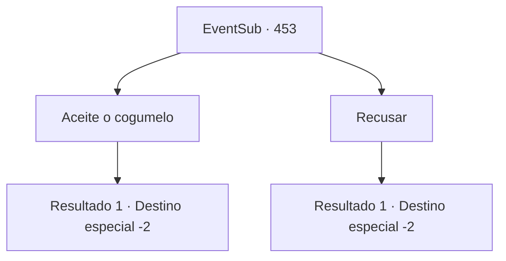

# Eventos secundários · 453

[Índice da tabela](index.md) · [Índice geral](../index.md)

ID: `pt:EventSub:453` · Fonte: `EventSub4` · Versão: 1.2.47.

Mapeamento estático dos arquivos; a disponibilidade e a execução dependem do estado da run.

## Texto do evento

*Sem texto no arquivo.*

## Dados de entrada

```json
{
  "id": 453,
  "grade": 1,
  "subEvent": "",
  "required": ""
}
```

## Mapa das escolhas



## Escolhas e resultados

### Escolha 1

Aceite o cogumelo

Requisitos e outros campos da escolha:

```json
{
  "required": ""
}
```

#### Resultado 1.1

Você pega o cogumelo trollear de Lorutu e o guarda cuidadosamente em sua mochila. 

 "Não vou esquecer de você! Obrigado, de verdade!!"

 O menino se curva mais uma vez e desaparece na floresta.

Continuação registrada: [Destino especial `-2`](../destinos-especiais.md).

```json
{
  "required": "",
  "chance": "1",
  "nextEvent": -2,
  "type": 2,
  "reward": "3_134_1|14_8_12|14_8_15"
}
```

### Escolha 2

Recusar

Requisitos e outros campos da escolha:

```json
{
  "required": ""
}
```

#### Resultado 2.1

Você devolve o cogumelo trollear para Lorutu. Enquanto ele parece um pouco triste, você o abraça e acaricia sua cabeça. Então Lorutu lhe dá um sorriso. 

 "Não vou esquecer de você! Muito obrigado mesmo!!"

 O menino se curva mais uma vez e desaparece na floresta.

Continuação registrada: [Destino especial `-2`](../destinos-especiais.md).

```json
{
  "required": "",
  "chance": "1",
  "nextEvent": -2,
  "type": 2,
  "reward": "0_3_3|14_8_12|14_8_15"
}
```

## Referências que chegam a este evento

- [Evento 452 · escolha 1 · resultado 1](0452.md#escolha-1)
