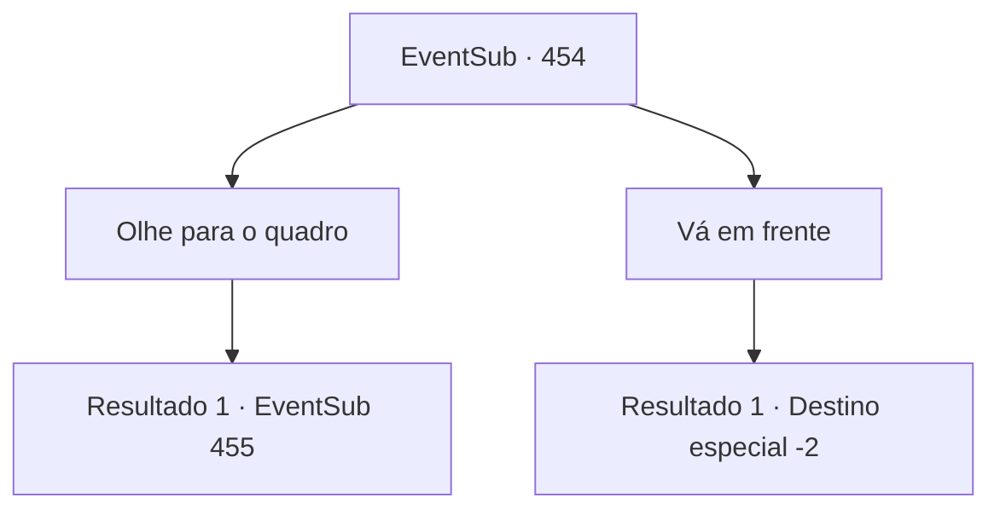

# Eventos secundários · 454

[Índice da tabela](index.md) · [Índice geral](../index.md)

ID: `pt:EventSub:454` · Fonte: `EventSub4` · Versão: 1.2.47.

Mapeamento estático dos arquivos; a disponibilidade e a execução dependem do estado da run.

## Texto do evento

Você se depara com um grupo de pessoas reunidas em uma praça na cidade de 'Tutan', que foi construída por humanos e anões juntos. Entre eles estão aventureiros, cavaleiros, fazendeiros e comerciantes, todos discutindo animadamente o post no quadro.

## Dados de entrada

```json
{
  "id": 454,
  "grade": 1,
  "subEvent": "",
  "required": "12_9_0"
}
```

## Mapa das escolhas



## Escolhas e resultados

### Escolha 1

Olhe para o quadro

Requisitos e outros campos da escolha:

```json
{
  "required": ""
}
```

#### Resultado 1.1

Você empurra anões com suas pernas e humanos com seus ombros e se espreme pela multidão. Você verifica o quadro de avisos. Há um pergaminho especialmente grande pendurado no quadro. Uma mulher chamada 'Sartha' foi capturada pelo Dragão Azul. No pergaminho está escrito: 'Permitirei que a pessoa que a salva se torne sua companheira.' Também há um retrato do Dragão Azul, que parece ser o suspeito.

Continuação registrada: [Evento 455](0455.md) na mesma tabela.

```json
{
  "required": "",
  "chance": "1",
  "nextEvent": 455,
  "type": 2,
  "reward": ""
}
```

### Escolha 2

Vá em frente

Requisitos e outros campos da escolha:

```json
{
  "required": ""
}
```

#### Resultado 2.1

Você ignora as pessoas agitadas e passa pelo mural de avisos.

Continuação registrada: [Destino especial `-2`](../destinos-especiais.md).

```json
{
  "required": "",
  "chance": "1",
  "nextEvent": -2,
  "type": 2,
  "reward": "12_9_-1"
}
```

## Referências que chegam a este evento

Nenhum `nextEvent` positivo da mesma tabela aponta para este nó. Isso não prova que seja inacessível: sorteio e estado de história podem selecioná-lo.

