# Eventos secundários · 455

[Índice da tabela](index.md) · [Índice geral](../index.md)

ID: `pt:EventSub:455` · Fonte: `EventSub4` · Versão: 1.2.47.

Mapeamento estático dos arquivos; a disponibilidade e a execução dependem do estado da run.

## Texto do evento

*Sem texto no arquivo.*

## Dados de entrada

```json
{
  "id": 455,
  "grade": 1,
  "subEvent": "",
  "required": ""
}
```

## Mapa das escolhas

```mermaid
flowchart TD
  E["EventSub · 455"]
  C0["Quem é &#x27;Sartha&#x27;?"]
  E --> C0
  R0_0["Resultado 1 · EventSub 456"]
  C0 --> R0_0
```



## Escolhas e resultados

### Escolha 1

Quem é 'Sartha'?

Requisitos e outros campos da escolha:

```json
{
  "required": ""
}
```

#### Resultado 1.1

Sua pergunta é respondida por um anão com uma barba avermelhada ao seu lado. 

 "Oh meu Deus...! Você não conhece Sartha? Tsk... o que você tem feito com sua vida?"

 Ele estala a língua e olha para você com pena. Então ele explica quem é Sartha. 

 "Oh... Sartha é filha de Radan Tess, que é o Senhor de Radania. Ela é famosa como a mulher mais bonita do mundo. Para ver o rosto dela apenas uma vez, as pessoas vão se aglomerar em Radania e nas cidades vizinhas. Eu não sei muito sobre isso, mas a fila de pessoas esperando para vê-la vai encher nosso poço de mineração de cobre."


Continuação registrada: [Evento 456](0456.md) na mesma tabela.

```json
{
  "required": "",
  "chance": "1",
  "nextEvent": 456,
  "type": 2,
  "reward": ""
}
```

## Referências que chegam a este evento

- [Evento 454 · escolha 1 · resultado 1](0454.md#escolha-1)
