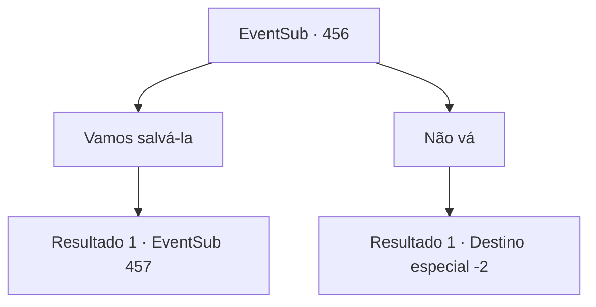

# Eventos secundários · 456

[Índice da tabela](index.md) · [Índice geral](../index.md)

ID: `pt:EventSub:456` · Fonte: `EventSub4` · Versão: 1.2.47.

Mapeamento estático dos arquivos; a disponibilidade e a execução dependem do estado da run.

## Texto do evento

*Sem texto no arquivo.*

## Dados de entrada

```json
{
  "id": 456,
  "grade": 1,
  "subEvent": "",
  "required": ""
}
```

## Mapa das escolhas



## Escolhas e resultados

### Escolha 1

Vamos salvá-la

Requisitos e outros campos da escolha:

```json
{
  "required": ""
}
```

#### Resultado 1.1

Enquanto você olha para o aviso e memoriza o retrato do Dragão Azul, o anão de barba avermelhada fala novamente. 

 "Hmm... Parece que você quer encontrar Sartha. Ouvi dizer que o Dragão Azul voou para algum lugar no Grande Deserto. Vá para 'Antitikarr'. Lá, você encontrará pessoas atravessando o deserto em caravanas. Se você perguntar a eles, eles podem saber algo."


Continuação registrada: [Evento 457](0457.md) na mesma tabela.

```json
{
  "required": "",
  "chance": "1",
  "nextEvent": 457,
  "type": 2,
  "reward": ""
}
```

### Escolha 2

Não vá

Requisitos e outros campos da escolha:

```json
{
  "required": ""
}
```

#### Resultado 2.1

Você se abre caminho pela multidão e sai de lá.

Continuação registrada: [Destino especial `-2`](../destinos-especiais.md).

```json
{
  "required": "",
  "chance": "1",
  "nextEvent": -2,
  "type": 2,
  "reward": "12_9_-1"
}
```

## Referências que chegam a este evento

- [Evento 455 · escolha 1 · resultado 1](0455.md#escolha-1)
