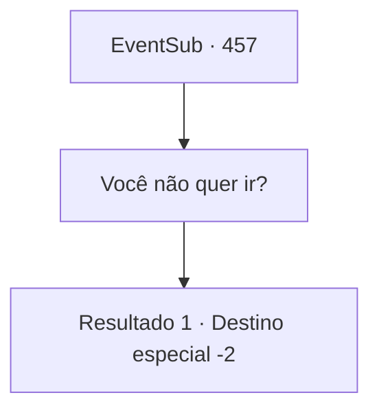

# Eventos secundários · 457

[Índice da tabela](index.md) · [Índice geral](../index.md)

ID: `pt:EventSub:457` · Fonte: `EventSub4` · Versão: 1.2.47.

Mapeamento estático dos arquivos; a disponibilidade e a execução dependem do estado da run.

## Texto do evento

*Sem texto no arquivo.*

## Dados de entrada

```json
{
  "id": 457,
  "grade": 1,
  "subEvent": "",
  "required": ""
}
```

## Mapa das escolhas



## Escolhas e resultados

### Escolha 1

Você não quer ir?

Requisitos e outros campos da escolha:

```json
{
  "required": ""
}
```

#### Resultado 1.1

Então o anão esfrega sua barba e ri. 

 "Eu sou apenas um ferreiro. Serei um assado delicioso se enfrentar um dragão. Desejo-lhe boa sorte."

 Após falar com o anão, você segue para Antitikarr, uma cidade central onde as caravanas do deserto se reúnem.

Continuação registrada: [Destino especial `-2`](../destinos-especiais.md).

```json
{
  "required": "",
  "chance": "1",
  "nextEvent": -2,
  "type": 2,
  "reward": "12_9_1"
}
```

## Referências que chegam a este evento

- [Evento 456 · escolha 1 · resultado 1](0456.md#escolha-1)
