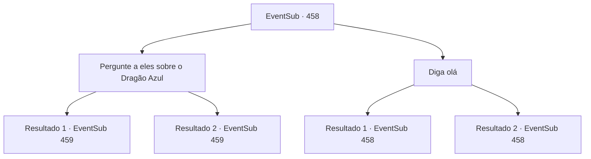

# Eventos secundários · 458

[Índice da tabela](index.md) · [Índice geral](../index.md)

ID: `pt:EventSub:458` · Fonte: `EventSub4` · Versão: 1.2.47.

Mapeamento estático dos arquivos; a disponibilidade e a execução dependem do estado da run.

## Texto do evento

|drawing_antitikarr| Você chegou em 'Antitikarr', É uma vila que serve como refúgio para viajantes que estão atravessando o deserto. No centro da vila há um grande oásis. Ao redor dele, há fileiras de prédios amarelos feitos de tijolos de adobe. Você nota algumas pessoas acompanhadas por vários camelos, cobrindo seus corpos e rostos com panos leves.

## Dados de entrada

```json
{
  "id": 458,
  "grade": 1,
  "subEvent": "",
  "required": "12_9_1|1_2_10"
}
```

## Mapa das escolhas



## Escolhas e resultados

### Escolha 1

Pergunte a eles sobre o Dragão Azul

Requisitos e outros campos da escolha:

```json
{
  "required": ""
}
```

#### Resultado 1.1

O comerciante te analisa de cima a baixo e abre a boca. 

 "Não há nada de graça nesse mundo. Você pode comprar a informação com ouro."

 Ele diz que vai te contar o que sabe se você pagar 100 ouros.

Continuação registrada: [Evento 459](0459.md) na mesma tabela.

```json
{
  "required": "18_441_1",
  "chance": "1",
  "nextEvent": 459,
  "type": 2,
  "reward": "5_442_1"
}
```

#### Resultado 1.2

O comerciante te analisa de cima a baixo e abre a boca. 

 "Não há nada de graça nesse mundo. Você pode comprar a informação com ouro."

 Ele diz que vai te contar o que sabe se você pagar 50 ouros.

Continuação registrada: [Evento 459](0459.md) na mesma tabela.

```json
{
  "required": "5_441_1",
  "chance": "1",
  "nextEvent": 459,
  "type": 2,
  "reward": "5_442_2"
}
```

### Escolha 2

Diga olá

Requisitos e outros campos da escolha:

```json
{
  "required": "5_441_0"
}
```

#### Resultado 2.1

Você cumprimenta o comerciante com um sorriso. Ele sorri de volta para você. 

 "Prazer em conhecê-lo. O clima está tão bom hoje. Talvez seja um sinal de que eu estava destinado a te encontrar aqui."


Continuação registrada: [Evento 458](0458.md) na mesma tabela.

```json
{
  "required": "",
  "chance": "1|0_12_1",
  "nextEvent": 458,
  "type": 0,
  "reward": "5_441_1"
}
```

#### Resultado 2.2

Você cumprimenta o comerciante com um sorriso. Ele sorri de volta para você. 

 "Então, o que posso fazer por você?"


Continuação registrada: [Evento 458](0458.md) na mesma tabela.

```json
{
  "required": "",
  "chance": "16",
  "nextEvent": 458,
  "type": 1,
  "reward": "5_441_2"
}
```

## Referências que chegam a este evento

- [Evento 458 · escolha 2 · resultado 1](0458.md#escolha-2)
- [Evento 458 · escolha 2 · resultado 2](0458.md#escolha-2)
