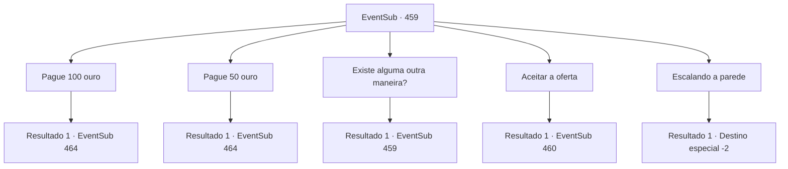

# Eventos secundários · 459

[Índice da tabela](index.md) · [Índice geral](../index.md)

ID: `pt:EventSub:459` · Fonte: `EventSub4` · Versão: 1.2.47.

Mapeamento estático dos arquivos; a disponibilidade e a execução dependem do estado da run.

## Texto do evento

*Sem texto no arquivo.*

## Dados de entrada

```json
{
  "id": 459,
  "grade": 1,
  "subEvent": "",
  "required": ""
}
```

## Mapa das escolhas



## Escolhas e resultados

### Escolha 1

Pague 100 ouro

Requisitos e outros campos da escolha:

```json
{
  "required": "5_442_1|1_4_100"
}
```

#### Resultado 1.1

Você paga ao comerciante ouro para comprar informações. O comerciante compartilha o que ele sabe sobre o dragão com um sorriso gentil. 

 "O Dragão Azul gosta de coisas que brilham. Você precisa de algo brilhante para usar como isca para atraí-lo. Muitas coisas brilhantes, na verdade."

 Ele diz que pode conseguir isca para você se você pagar uma taxa adicional. 

 "400 ouro. Eu preciso dessa quantia para fazer uma isca que possa chamar a atenção de um dragão."


Continuação registrada: [Evento 464](0464.md) na mesma tabela.

```json
{
  "required": "",
  "chance": "1",
  "nextEvent": 464,
  "type": 2,
  "reward": "0_4_-100"
}
```

### Escolha 2

Pague 50 ouro

Requisitos e outros campos da escolha:

```json
{
  "required": "5_442_2|1_4_50"
}
```

#### Resultado 2.1

Você paga ao comerciante ouro para comprar informações. O comerciante compartilha o que ele sabe sobre o dragão com um sorriso gentil. 

 "O Dragão Azul gosta de coisas que brilham. Você precisa de algo brilhante para usar como isca para atraí-lo. Muitas coisas brilhantes, na verdade."

 Ele diz que pode conseguir isca para você se você pagar uma taxa adicional. 

 "400 ouro. Eu preciso dessa quantia para fazer uma isca que possa chamar a atenção de um dragão."


Continuação registrada: [Evento 464](0464.md) na mesma tabela.

```json
{
  "required": "",
  "chance": "1",
  "nextEvent": 464,
  "type": 2,
  "reward": "0_4_-50"
}
```

### Escolha 3

Existe alguma outra maneira?

Requisitos e outros campos da escolha:

```json
{
  "required": "5_443_0"
}
```

#### Resultado 3.1

O comerciante responde à sua pergunta enquanto puxa o bigode. 

 "Claro, há outra maneira de obter a informação. Olhe aqui."

 Ele tira um mapa e mostra para você. 

 "Olhe aqui. Há uma montanha rochosa com uma caverna aqui. E há basiliscos vivendo nessa caverna."

 O comerciante diz que os basiliscos costumam atacar caravanas, então ele pede para você se livrar deles.

Continuação registrada: [Evento 459](0459.md) na mesma tabela.

```json
{
  "required": "",
  "chance": "1",
  "nextEvent": 459,
  "type": 2,
  "reward": "5_443_1"
}
```

### Escolha 4

Aceitar a oferta

Requisitos e outros campos da escolha:

```json
{
  "required": "5_443_1"
}
```

#### Resultado 4.1

Você aceita a oferta do comerciante. O comerciante te ajuda a subir em um de seus camelos. 

 "O sol e a areia no deserto estão muito quentes para caminhar a pé, então eu vou te levar até lá."|drawing_desertRock| Então você monta em um camelo e chega confortavelmente à montanha. No meio dessa montanha vermelha e rochosa há uma entrada para uma grande caverna. 

 "Tudo bem, cuide-se."

 O comerciante diz que vai ficar com os camelos e esperar na entrada.

Continuação registrada: [Evento 460](0460.md) na mesma tabela.

```json
{
  "required": "",
  "chance": "1",
  "nextEvent": 460,
  "type": 2,
  "reward": ""
}
```

### Escolha 5

Escalando a parede

Requisitos e outros campos da escolha:

```json
{
  "required": ""
}
```

#### Resultado 5.1

Você desiste de procurar pelo dragão azul e vira as costas para o comerciante.

Continuação registrada: [Destino especial `-2`](../destinos-especiais.md).

```json
{
  "required": "",
  "chance": "1",
  "nextEvent": -2,
  "type": 2,
  "reward": ""
}
```

## Referências que chegam a este evento

- [Evento 458 · escolha 1 · resultado 1](0458.md#escolha-1)
- [Evento 458 · escolha 1 · resultado 2](0458.md#escolha-1)
- [Evento 459 · escolha 3 · resultado 1](0459.md#escolha-3)
