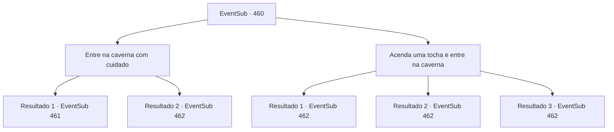

# Eventos secundários · 460

[Índice da tabela](index.md) · [Índice geral](../index.md)

ID: `pt:EventSub:460` · Fonte: `EventSub4` · Versão: 1.2.47.

Mapeamento estático dos arquivos; a disponibilidade e a execução dependem do estado da run.

## Texto do evento

*Sem texto no arquivo.*

## Dados de entrada

```json
{
  "id": 460,
  "grade": 1,
  "subEvent": "",
  "required": ""
}
```

## Mapa das escolhas



## Escolhas e resultados

### Escolha 1

Entre na caverna com cuidado

Requisitos e outros campos da escolha:

```json
{
  "required": ""
}
```

#### Resultado 1.1

Você entra na caverna com cautela. Você pode ouvir a respiração dos basiliscos vindo de dentro da caverna seca. Você caminha cuidadosamente mais fundo na caverna. Você alcança uma pequena saliência e vê três basiliscos descansando no chão abaixo de você.

Continuação registrada: [Evento 461](0461.md) na mesma tabela.

```json
{
  "required": "",
  "chance": "1|0_14_1",
  "nextEvent": 461,
  "type": 0,
  "reward": ""
}
```

#### Resultado 1.2

Você entra na caverna com cautela. Mas ao adentrar nesta caverna seca, você se depara com uma basilisco de frente. E então não apenas um, mas mais dois surgem das sombras. Eles te encaram com seu olhar petrificante.

Continuação registrada: [Evento 462](0462.md) na mesma tabela.

```json
{
  "required": "",
  "chance": "13",
  "nextEvent": 462,
  "type": 1,
  "reward": ""
}
```

### Escolha 2

Acenda uma tocha e entre na caverna

Requisitos e outros campos da escolha:

```json
{
  "required": ""
}
```

#### Resultado 2.1

Você entra na caverna com uma tocha acesa. Você pode ouvir a respiração dos basiliscos vinda do fundo da caverna seca. Você caminha cuidadosamente mais fundo na caverna. Você chega a uma pequena saliência e vê três basiliscos descansando no chão abaixo de você. E graças à luz, eles também te veem. Eles te encaram com um olhar petrificante assim que te avistam.

Continuação registrada: [Evento 462](0462.md) na mesma tabela.

```json
{
  "required": "23_3_1",
  "chance": "1",
  "nextEvent": 462,
  "type": 2,
  "reward": ""
}
```

#### Resultado 2.2

Você entra na caverna com uma tocha acesa. Você pode ouvir a respiração dos basiliscos vinda do fundo da caverna seca. Você caminha cuidadosamente mais fundo na caverna. Você chega a uma pequena saliência e vê três basiliscos descansando no chão abaixo de você. E graças à luz, eles também te veem. Eles te encaram com um olhar petrificante assim que te avistam.

Continuação registrada: [Evento 462](0462.md) na mesma tabela.

```json
{
  "required": "20_0_1",
  "chance": "1",
  "nextEvent": 462,
  "type": 2,
  "reward": ""
}
```

#### Resultado 2.3

Você acha que seria bom acender uma fogueira, mas não tem uma maneira adequada de fazer isso. Eventualmente, você entra em uma caverna escura. Mas depois de entrar nesta caverna seca, você se depara com uma cabeça de basilisco de frente. E então não apenas uma, mas mais duas aparecem das trevas. Elas te encaram com seu olhar petrificante.

Continuação registrada: [Evento 462](0462.md) na mesma tabela.

```json
{
  "required": "21_0_1|24_3_1",
  "chance": "1",
  "nextEvent": 462,
  "type": 2,
  "reward": ""
}
```

## Referências que chegam a este evento

- [Evento 459 · escolha 4 · resultado 1](0459.md#escolha-4)
- [Evento 464 · escolha 1 · resultado 4](0464.md#escolha-1)
- [Evento 464 · escolha 1 · resultado 5](0464.md#escolha-1)
- [Evento 464 · escolha 5 · resultado 1](0464.md#escolha-5)
