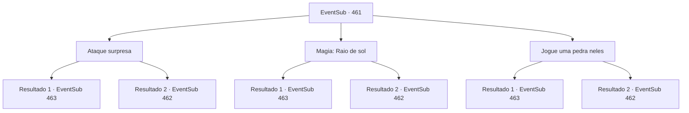

# Eventos secundários · 461

[Índice da tabela](index.md) · [Índice geral](../index.md)

ID: `pt:EventSub:461` · Fonte: `EventSub4` · Versão: 1.2.47.

Mapeamento estático dos arquivos; a disponibilidade e a execução dependem do estado da run.

## Texto do evento

*Sem texto no arquivo.*

## Dados de entrada

```json
{
  "id": 461,
  "grade": 1,
  "subEvent": "",
  "required": ""
}
```

## Mapa das escolhas



## Escolhas e resultados

### Escolha 1

Ataque surpresa

Requisitos e outros campos da escolha:

```json
{
  "required": ""
}
```

#### Resultado 1.1

Você pula em cima de um basilisco e acerta sua cabeça. O som de seus ossos quebrando ecoa pela caverna. O basilisco que você atingiu cai no chão com os membros espalhados. E logo em seguida, os outros dois pulam em cima de você.

Continuação registrada: [Evento 463](0463.md) na mesma tabela.

```json
{
  "required": "",
  "chance": "1|0_6_1",
  "nextEvent": 463,
  "type": 0,
  "reward": "6_2_121",
  "place": 6
}
```

#### Resultado 1.2

Você pula em direção a uma basilisco e mira em sua cabeça. Mas ela evita seu ataque. Imediatamente, a basilisco te encara com seu olhar petrificante.

Continuação registrada: [Evento 462](0462.md) na mesma tabela.

```json
{
  "required": "",
  "chance": "12",
  "nextEvent": 462,
  "type": 1,
  "reward": ""
}
```

### Escolha 2

Magia: Raio de sol

Requisitos e outros campos da escolha:

```json
{
  "required": "20_0_3|1_1_2"
}
```

#### Resultado 2.1

Você cria um intenso flash de luz com magia. E você o dispara nos basiliscos. Cegos pelo flash repentino, eles gritam e fecham os olhos. 

 "--Gritando--!!"

 Eles correm em sua direção em um frenesi.

Continuação registrada: [Evento 463](0463.md) na mesma tabela.

```json
{
  "required": "",
  "chance": "1|0_7_1|0_12_1",
  "nextEvent": 463,
  "type": 0,
  "reward": "6_2_121|0_1_-1",
  "place": 6
}
```

#### Resultado 2.2

Você tenta criar um poderoso lampejo de magia, mas você erra a entoação. Enquanto isso, os basiliscos percebem você e te encaram com seu olhar petrificante.

Continuação registrada: [Evento 462](0462.md) na mesma tabela.

```json
{
  "required": "",
  "chance": "20",
  "nextEvent": 462,
  "type": 1,
  "reward": "0_1_-1"
}
```

### Escolha 3

Jogue uma pedra neles

Requisitos e outros campos da escolha:

```json
{
  "required": ""
}
```

#### Resultado 3.1

Você empurra uma pedra que estava deitada na caverna e a deixa cair em cima de um dos basiliscos. A grande pedra cai na cabeça do basilisco e esmaga seu crânio. Logo em seguida, os outros dois pulam em cima de você.

Continuação registrada: [Evento 463](0463.md) na mesma tabela.

```json
{
  "required": "",
  "chance": "1|0_5_1",
  "nextEvent": 463,
  "type": 0,
  "reward": "6_2_121",
  "place": 6
}
```

#### Resultado 3.2

Você empurra uma pedra que estava deitada na caverna e tenta deixá-la cair na cabeça de um basilisco. Mas, apesar de suas intenções, a grande pedra acerta o chão ao lado dos basiliscos. Imediatamente, os basiliscos te encaram com seu olhar petrificante.

Continuação registrada: [Evento 462](0462.md) na mesma tabela.

```json
{
  "required": "",
  "chance": "15",
  "nextEvent": 462,
  "type": 1,
  "reward": ""
}
```

## Referências que chegam a este evento

- [Evento 460 · escolha 1 · resultado 1](0460.md#escolha-1)
