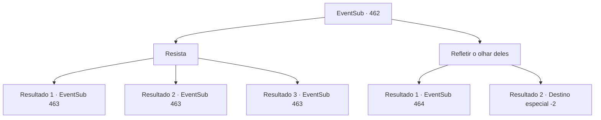

# Eventos secundários · 462

[Índice da tabela](index.md) · [Índice geral](../index.md)

ID: `pt:EventSub:462` · Fonte: `EventSub4` · Versão: 1.2.47.

Mapeamento estático dos arquivos; a disponibilidade e a execução dependem do estado da run.

## Texto do evento

*Sem texto no arquivo.*

## Dados de entrada

```json
{
  "id": 462,
  "grade": 1,
  "subEvent": "",
  "required": ""
}
```

## Mapa das escolhas



## Escolhas e resultados

### Escolha 1

Resista

Requisitos e outros campos da escolha:

```json
{
  "required": ""
}
```

#### Resultado 1.1

Você resiste ao olhar deles. Eles são pegos de surpresa, mas rapidamente te atacam novamente.

Continuação registrada: [Evento 463](0463.md) na mesma tabela.

```json
{
  "required": "24_7_1",
  "chance": "1|0_13_1",
  "nextEvent": 463,
  "type": 0,
  "reward": "6_0_121",
  "place": 6
}
```

#### Resultado 1.2

Você não consegue resistir ao olhar deles.  Seu corpo começa a endurecer lentamente.  Para piorar as coisas, os basiliscos começam a te atacar.

Continuação registrada: [Evento 463](0463.md) na mesma tabela.

```json
{
  "required": "24_7_1",
  "chance": "16",
  "nextEvent": 463,
  "type": 1,
  "reward": "6_3_121",
  "place": 6
}
```

#### Resultado 1.3

Você resiste ao olhar deles. Eles são pegos de surpresa, mas rapidamente te atacam novamente.

Continuação registrada: [Evento 463](0463.md) na mesma tabela.

```json
{
  "required": "23_7_1",
  "chance": "1",
  "nextEvent": 463,
  "type": 2,
  "reward": "6_0_121",
  "place": 6
}
```

### Escolha 2

Refletir o olhar deles

Requisitos e outros campos da escolha:

```json
{
  "required": "8_148_1"
}
```

#### Resultado 2.1

Você levanta a 'Face da Medusa' e bloqueia o olhar do basilisco. Você não consegue mais ouvi-los respirar. Sua habilidade foi refletida de volta para eles, e eles se transformam em pedras no local. Depois de derrotar os basiliscos, você pega uma de suas cabeças como troféu. Você olha ao redor para ver se há mais deles. Mas não há mais basiliscos. Apenas os ossos de todas as pessoas que eles mataram. Você sai da caverna e se aproxima do comerciante. 

 "O que... você cumpriu o pedido?"

 Ele pergunta, levantando suas sobrancelhas grossas. Você diz que se livrou dos basiliscos e joga a cabeça do basilisco nele como prova. O comerciante dá um pulo para trás com um grito curto. Ele rapidamente se recompõe e aperta sua mão. 

 "Hmm...! Obrigado. Graças a você, os comerciantes estarão mais seguros em suas viagens."

 Ele então lhe dá informações sobre o Dragão Azul, como prometido. 

 "O Dragão Azul gosta de coisas que brilham. Você precisa de algo brilhante para usar como isca para atraí-lo. Muitas coisas brilhantes, na verdade. Eu precisaria de 400 ouros para fazer uma isca que possa chamar a atenção de um dragão."


Continuação registrada: [Evento 464](0464.md) na mesma tabela.

```json
{
  "required": "18_977_1",
  "chance": "1",
  "nextEvent": 464,
  "type": 2,
  "reward": "0_2_1|5_444_1"
}
```

#### Resultado 2.2

Você levanta a 'Face da Medusa' e bloqueia o olhar do basilisco. Você não consegue mais ouvi-los respirar. Sua habilidade foi refletida de volta para eles, e eles se transformam em pedras no local. Depois de derrotar os basiliscos, você pega uma de suas cabeças como troféu. Você olha ao redor para ver se há mais deles. Mas não há mais basiliscos. Apenas os ossos de todas as pessoas que eles mataram. Você sai da caverna e se aproxima do comerciante. 

 "O que... você cumpriu o pedido?"

 Ele pergunta, levantando suas sobrancelhas grossas. Você diz que se livrou dos basiliscos e joga a cabeça do basilisco nele como prova. O comerciante dá um pulo para trás com um grito curto. Ele rapidamente se recompõe e aperta sua mão. 

 "Hmm...! Obrigado. Graças a você, os comerciantes estarão mais seguros em suas viagens."

 Ele acena com um sorriso satisfeito. 

 "Já que você derrotou o basilisco, nós cuidaremos de preparar a isca. Ah, agora que lembro, ainda não me apresentei. Meu nome é Dowd. Deve levar cerca de uma semana para deixar tudo pronto, então me procure em Antitikar depois disso. Mesmo que eu não esteja lá, fale com um dos membros da nossa companhia mercantil e eles vão te ajudar. Procure pelo emblema do escorpião negro."

 Ele se despede e sai para preparar a isca.

Continuação registrada: [Destino especial `-2`](../destinos-especiais.md).

```json
{
  "required": "5_977_1",
  "chance": "1",
  "nextEvent": -2,
  "type": 2,
  "reward": "12_9_2"
}
```

## Referências que chegam a este evento

- [Evento 460 · escolha 1 · resultado 2](0460.md#escolha-1)
- [Evento 460 · escolha 2 · resultado 1](0460.md#escolha-2)
- [Evento 460 · escolha 2 · resultado 2](0460.md#escolha-2)
- [Evento 460 · escolha 2 · resultado 3](0460.md#escolha-2)
- [Evento 461 · escolha 1 · resultado 2](0461.md#escolha-1)
- [Evento 461 · escolha 2 · resultado 2](0461.md#escolha-2)
- [Evento 461 · escolha 3 · resultado 2](0461.md#escolha-3)
