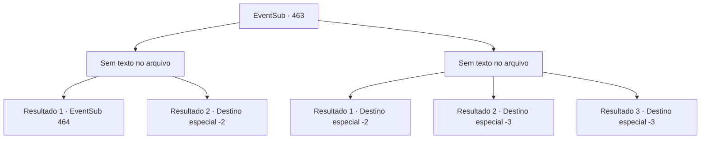

# Eventos secundários · 463

[Índice da tabela](index.md) · [Índice geral](../index.md)

ID: `pt:EventSub:463` · Fonte: `EventSub4` · Versão: 1.2.47.

Mapeamento estático dos arquivos; a disponibilidade e a execução dependem do estado da run.

## Texto do evento

*Sem texto no arquivo.*

## Dados de entrada

```json
{
  "id": 463,
  "grade": 1,
  "subEvent": "",
  "required": ""
}
```

## Mapa das escolhas



## Escolhas e resultados

### Escolha 1

*Sem texto no arquivo; o papel dessa opção depende da interface do jogo.*

Requisitos e outros campos da escolha:

```json
{
  "required": ""
}
```

#### Resultado 1.1

Depois de derrotar os basiliscos, você pega uma das cabeças deles como troféu. Você olha ao redor para ver se há mais deles. Mas não há mais basiliscos. Apenas os ossos de todas as pessoas que eles mataram. Você sai da caverna e se aproxima do comerciante. 

 "O que... você cumpriu o pedido?"

 Ele pergunta, levantando suas sobrancelhas grossas. Você diz que se livrou dos basiliscos e joga a cabeça do basilisco nele como prova. O comerciante dá um pulo para trás com um grito curto. Ele rapidamente se recompõe e aperta sua mão. 

 "Hmm...! Obrigado. Graças a você, os comerciantes estarão mais seguros em suas viagens."

 Ele então lhe dá informações sobre o Dragão Azul, como prometido. 

 "O Dragão Azul gosta de coisas que brilham. Você precisa de algo brilhante para usar como isca para atraí-lo. Muitas coisas brilhantes, na verdade. Eu precisaria de 400 ouros para fazer uma isca que possa chamar a atenção de um dragão."


Continuação registrada: [Evento 464](0464.md) na mesma tabela.

```json
{
  "required": "18_977_1",
  "chance": "1",
  "nextEvent": 464,
  "type": 2,
  "reward": "5_444_1"
}
```

#### Resultado 1.2

Depois de derrotar os basiliscos, você pega uma das cabeças deles como troféu. Você olha ao redor para ver se há mais deles. Mas não há mais basiliscos. Apenas os ossos de todas as pessoas que eles mataram. Você sai da caverna e se aproxima do comerciante. 

 "O que... você cumpriu o pedido?"

 Ele pergunta, levantando suas sobrancelhas grossas. Você diz que se livrou dos basiliscos e joga a cabeça do basilisco nele como prova. O comerciante dá um pulo para trás com um grito curto. Ele rapidamente se recompõe e aperta sua mão. 

 "Hmm...! Obrigado. Graças a você, os comerciantes estarão mais seguros em suas viagens."

 Ele acena com um sorriso satisfeito. 

 "Já que você derrotou o basilisco, nós cuidaremos de preparar a isca. Ah, agora que lembro, ainda não me apresentei. Meu nome é Dowd. Deve levar cerca de uma semana para deixar tudo pronto, então me procure em Antitikar depois disso. Mesmo que eu não esteja lá, fale com um dos membros da nossa companhia mercantil e eles vão te ajudar. Procure pelo emblema do escorpião negro."

 Ele se despede e sai para preparar a isca.

Continuação registrada: [Destino especial `-2`](../destinos-especiais.md).

```json
{
  "required": "5_977_1",
  "chance": "1",
  "nextEvent": -2,
  "type": 2,
  "reward": "12_9_2"
}
```

### Escolha 2

*Sem texto no arquivo; o papel dessa opção depende da interface do jogo.*

Requisitos e outros campos da escolha:

```json
{
  "required": ""
}
```

#### Resultado 2.1

Você consegue escapar dos basiliscos.  Quando finalmente sai da caverna, o comerciante que estava esperando por você se aproxima.  Ele olha para você com as sobrancelhas grossas levantadas.  

 "Parece que você falhou. Que pena."

  Sem mais nada a dizer, o comerciante parte em um camelo.

Continuação registrada: [Destino especial `-2`](../destinos-especiais.md).

```json
{
  "required": "1_0_2|1_1_2",
  "chance": "1",
  "nextEvent": -2,
  "type": 2,
  "reward": "0_0_-1|0_1_-1|12_9_-1"
}
```

#### Resultado 2.2

O basilisco abre sua enorme boca e te devora.  Cada basilisco quer um pedaço de carne para si.  Eles te rasgam e você se torna o jantar deles.

Continuação registrada: [Destino especial `-3`](../destinos-especiais.md).

```json
{
  "required": "2_0_2",
  "chance": "1",
  "nextEvent": -3,
  "type": 2,
  "reward": "0_0_-1|0_1_-1"
}
```

#### Resultado 2.3

O basilisco abre sua enorme boca e te devora.  Cada basilisco quer um pedaço de carne para si.  Eles te rasgam e você se torna o jantar deles.

Continuação registrada: [Destino especial `-3`](../destinos-especiais.md).

```json
{
  "required": "2_1_2",
  "chance": "1",
  "nextEvent": -3,
  "type": 2,
  "reward": "0_0_-1|0_1_-1"
}
```

## Referências que chegam a este evento

- [Evento 461 · escolha 1 · resultado 1](0461.md#escolha-1)
- [Evento 461 · escolha 2 · resultado 1](0461.md#escolha-2)
- [Evento 461 · escolha 3 · resultado 1](0461.md#escolha-3)
- [Evento 462 · escolha 1 · resultado 1](0462.md#escolha-1)
- [Evento 462 · escolha 1 · resultado 2](0462.md#escolha-1)
- [Evento 462 · escolha 1 · resultado 3](0462.md#escolha-1)
