# Eventos secundários · 464

[Índice da tabela](index.md) · [Índice geral](../index.md)

ID: `pt:EventSub:464` · Fonte: `EventSub4` · Versão: 1.2.47.

Mapeamento estático dos arquivos; a disponibilidade e a execução dependem do estado da run.

## Texto do evento

*Sem texto no arquivo.*

## Dados de entrada

```json
{
  "id": 464,
  "grade": 1,
  "subEvent": "",
  "required": ""
}
```

## Mapa das escolhas

```mermaid
flowchart TD
  E["EventSub · 464"]
  C0["Pagar"]
  E --> C0
  R0_0["Resultado 1 · Destino especial -2"]
  C0 --> R0_0
  R0_1["Resultado 2 · Destino especial -2"]
  C0 --> R0_1
  R0_2["Resultado 3 · Destino especial -2"]
  C0 --> R0_2
  R0_3["Resultado 4 · EventSub 460"]
  C0 --> R0_3
  R0_4["Resultado 5 · EventSub 460"]
  C0 --> R0_4
  C1["Escalando a parede"]
  E --> C1
  R1_0["Resultado 1 · Destino especial -2"]
  C1 --> R1_0
  C2["Negociar o preço"]
  E --> C2
  R2_0["Resultado 1 · EventSub 464"]
  C2 --> R2_0
  R2_1["Resultado 2 · EventSub 464"]
  C2 --> R2_1
  R2_2["Resultado 3 · Destino especial -2"]
  C2 --> R2_2
  C3["Ameace-o"]
  E --> C3
  R3_0["Resultado 1 · Destino especial -2"]
  C3 --> R3_0
  R3_1["Resultado 2 · EventSub 464"]
  C3 --> R3_1
  R3_2["Resultado 3 · Destino especial -2"]
  C3 --> R3_2
  C4["Eu não tenho dinheiro"]
  E --> C4
  R4_0["Resultado 1 · EventSub 460"]
  C4 --> R4_0
  R4_1["Resultado 2 · Destino especial -2"]
  C4 --> R4_1
```



## Escolhas e resultados

### Escolha 1

Pagar

Requisitos e outros campos da escolha:

```json
{
  "required": ""
}
```

#### Resultado 1.1

Você paga o ouro ao comerciante. Ele acena com um sorriso satisfeito. 

 "Percebi que nunca me apresentei. Sou 'Dowd', um membro da caravana Sand Scorpion. Levará cerca de uma semana para fazer a isca, então venha me procurar depois disso. Basta perguntar a qualquer um dos membros da nossa caravana e eles o levarão até mim. Procure pelo padrão do escorpião preto."

 Ele se despede e sai para preparar a isca.

Continuação registrada: [Destino especial `-2`](../destinos-especiais.md).

```json
{
  "required": "18_444_1|18_445_1|1_4_400",
  "chance": "1",
  "nextEvent": -2,
  "type": 2,
  "reward": "12_9_2|0_4_-400"
}
```

#### Resultado 1.2

Você está prestes a pagar o ouro ao comerciante. Mas ele balança a cabeça com um sorriso satisfeito. 

 "Na verdade, já que você me fez um grande favor ao derrotar aqueles basiliscos, não vou pegar o seu ouro. Aliás, percebi que nunca me apresentei. Sou 'Dowd', um membro da caravana do Escorpião de Areia. Vai levar cerca de uma semana para fazer a isca, então venha me procurar depois disso. Basta perguntar a qualquer um dos membros da nossa caravana e eles te levarão até mim. Procure pelo padrão do escorpião preto."

 Ele se despede e sai para preparar a isca.

Continuação registrada: [Destino especial `-2`](../destinos-especiais.md).

```json
{
  "required": "5_444_1",
  "chance": "1",
  "nextEvent": -2,
  "type": 2,
  "reward": "12_9_2"
}
```

#### Resultado 1.3

Você paga o ouro ao comerciante. Ele acena com um sorriso satisfeito. 

 "Percebi que nunca me apresentei. Sou 'Dowd', um membro da caravana Sand Scorpion. Levará cerca de uma semana para fazer a isca, então venha me procurar depois disso. Basta perguntar a qualquer um dos membros da nossa caravana e eles o levarão até mim. Procure pelo padrão do escorpião preto."

 Ele se despede e sai para preparar a isca.

Continuação registrada: [Destino especial `-2`](../destinos-especiais.md).

```json
{
  "required": "18_444_1|5_445_1|1_4_300",
  "chance": "1",
  "nextEvent": -2,
  "type": 2,
  "reward": "12_9_2|0_4_-300"
}
```

#### Resultado 1.4

Você tenta pagar o mercador com ouro, mas a quantia não é suficiente. Então o comerciante diz que vai te ajudar se você fizer um favor para ele. Como você não tem outra escolha, concorda sem saber o que esse favor envolve. Então o comerciante te ajuda a subir em um de seus camelos. 

 "O sol e a areia no deserto estão muito quentes para andar a pé, então vou te levar até lá."|drawing_desertRock| Então você monta em um camelo e chega à base de uma montanha. No meio dessa montanha vermelha e rochosa há uma entrada para uma grande caverna. 

 "Quero que você destrua todos os basiliscos dessa caverna. Vá em frente."

 O comerciante diz que vai ficar com os camelos e esperar na entrada.

Continuação registrada: [Evento 460](0460.md) na mesma tabela.

```json
{
  "required": "18_444_1|18_445_1|2_4_400",
  "chance": "1",
  "nextEvent": 460,
  "type": 2,
  "reward": ""
}
```

#### Resultado 1.5

Você tenta pagar o mercador com ouro, mas a quantia não é suficiente. Então o comerciante diz que vai te ajudar se você fizer um favor para ele. Como você não tem outra escolha, concorda sem saber o que esse favor envolve. Então o comerciante te ajuda a subir em um de seus camelos. 

 "O sol e a areia no deserto estão muito quentes para andar a pé, então vou te levar até lá."|drawing_desertRock| Então você monta em um camelo e chega à base de uma montanha. No meio dessa montanha vermelha e rochosa há uma entrada para uma grande caverna. 

 "Quero que você destrua todos os basiliscos dessa caverna. Vá em frente."

 O comerciante diz que vai ficar com os camelos e esperar na entrada.

Continuação registrada: [Evento 460](0460.md) na mesma tabela.

```json
{
  "required": "18_444_1|5_445_1|2_4_300",
  "chance": "1",
  "nextEvent": 460,
  "type": 2,
  "reward": ""
}
```

### Escolha 2

Escalando a parede

Requisitos e outros campos da escolha:

```json
{
  "required": "18_444_1"
}
```

#### Resultado 2.1

Você desiste de procurar pelo dragão azul e vira as costas para o comerciante.

Continuação registrada: [Destino especial `-2`](../destinos-especiais.md).

```json
{
  "required": "",
  "chance": "1",
  "nextEvent": -2,
  "type": 2,
  "reward": "12_9_-1"
}
```

### Escolha 3

Negociar o preço

Requisitos e outros campos da escolha:

```json
{
  "required": "5_445_0|5_446_0"
}
```

#### Resultado 3.1

Você pede ao comerciante para baixar o preço. Ele hesita por um momento, então acena com a cabeça e responde. 

 "Tudo bem, me dê 300 ouros. Acho que ainda consigo fazer uma isca decente com isso."


Continuação registrada: [Evento 464](0464.md) na mesma tabela.

```json
{
  "required": "18_444_1",
  "chance": "1|0_12_1",
  "nextEvent": 464,
  "type": 0,
  "reward": "5_445_1"
}
```

#### Resultado 3.2

Você pede ao comerciante para baixar o preço. Ele hesita por um momento, então balança a cabeça e responde. 

 "400. Não posso baixar nem um centavo a menos."


Continuação registrada: [Evento 464](0464.md) na mesma tabela.

```json
{
  "required": "18_444_1",
  "chance": "20",
  "nextEvent": 464,
  "type": 1,
  "reward": "5_445_2"
}
```

#### Resultado 3.3

Você está prestes a pagar o ouro ao comerciante. Mas ele balança a cabeça com um sorriso satisfeito. 

 "Na verdade, já que você me fez um grande favor ao derrotar aqueles basiliscos, não vou pegar o seu ouro. Aliás, percebi que nunca me apresentei. Sou 'Dowd', um membro da caravana do Escorpião de Areia. Vai levar cerca de uma semana para fazer a isca, então venha me procurar depois disso. Basta perguntar a qualquer um dos membros da nossa caravana e eles te levarão até mim. Procure pelo padrão do escorpião preto."

 Ele se despede e sai para preparar a isca.

Continuação registrada: [Destino especial `-2`](../destinos-especiais.md).

```json
{
  "required": "5_444_1",
  "chance": "1",
  "nextEvent": -2,
  "type": 2,
  "reward": "12_9_2"
}
```

### Escolha 4

Ameace-o

Requisitos e outros campos da escolha:

```json
{
  "required": "2_3_0|5_446_0"
}
```

#### Resultado 4.1

Você agarra o comerciante pela gola e oferece poupar sua vida se ele se tornar a isca. 

 "V...Você vai me matar? Khmm..."

 O comerciante estremece e treme diante de suas ameaças. Ele acena desesperadamente e continua falando. 

 "Hahaha... Ok, eu farei isso. Mas vai... levar algum tempo para fazer a isca."

 Quando você o encara, ele continua rapidamente. 

 "Não estou tentando fugir. Meu... meu nome é Dowd. Se você procurar minha caravana, não terá dificuldade em me encontrar. Por que eu mentiria para você?"

 Dowd está agitando as mãos e tentando argumentar com você. Ele diz que irá encontrá-lo quando a isca estiver pronta. Você solta a gola dele e se afasta.

Continuação registrada: [Destino especial `-2`](../destinos-especiais.md).

```json
{
  "required": "21_1_3",
  "chance": "1|0_12_1",
  "nextEvent": -2,
  "type": 0,
  "reward": "5_446_2|0_3_-1|12_9_2"
}
```

#### Resultado 4.2

Você agarra o comerciante pela gola e oferece poupar sua vida se ele se tornar a isca. 

 "V...Você acha que pode me matar?"

 O comerciante não pisca diante de sua ameaça. 

 "Não me subestime. Sobrevivi a muitas jornadas pelo Grande Deserto. Acha que eu teria medo de um novato como você?"


Continuação registrada: [Evento 464](0464.md) na mesma tabela.

```json
{
  "required": "21_1_3",
  "chance": "14",
  "nextEvent": 464,
  "type": 1,
  "reward": "5_446_1|0_3_-1"
}
```

#### Resultado 4.3

Você agarra o comerciante pela gola e oferece poupar sua vida se ele se tornar a isca. 

 "V...Você vai me matar? Khmm..."

 O comerciante estremece e treme diante de suas ameaças. Ele acena desesperadamente e continua falando. 

 "Hahaha... Ok, eu farei isso. Mas vai... levar algum tempo para fazer a isca."

 Quando você o encara, ele continua rapidamente. 

 "Não estou tentando fugir. Meu... meu nome é Dowd. Se você procurar minha caravana, não terá dificuldade em me encontrar. Por que eu mentiria para você?"

 Dowd está agitando as mãos e tentando argumentar com você. Ele diz que irá encontrá-lo quando a isca estiver pronta. Você solta a gola dele e se afasta.

Continuação registrada: [Destino especial `-2`](../destinos-especiais.md).

```json
{
  "required": "20_1_3",
  "chance": "1",
  "nextEvent": -2,
  "type": 0,
  "reward": "5_446_2|0_3_-1|12_9_2"
}
```

### Escolha 5

Eu não tenho dinheiro

Requisitos e outros campos da escolha:

```json
{
  "required": ""
}
```

#### Resultado 5.1

Então o comerciante diz que vai te ajudar se você fizer um favor para ele. Como você não tem outra escolha, concorda sem saber o que esse favor envolve. Então o comerciante te ajuda a subir em um de seus camelos. 

 "O sol e a areia no deserto estão muito quentes para andar a pé, então vou te levar até lá."|drawing_desertRock| Então você monta em um camelo e chega à base de uma montanha. No meio dessa montanha vermelha e rochosa há uma entrada para uma grande caverna. 

 "Quero que você destrua todos os basiliscos dessa caverna. Vá em frente."

 O comerciante diz que vai ficar com os camelos e esperar na entrada.

Continuação registrada: [Evento 460](0460.md) na mesma tabela.

```json
{
  "required": "18_444_1",
  "chance": "1",
  "nextEvent": 460,
  "type": 2,
  "reward": "5_977_1"
}
```

#### Resultado 5.2

Quando você expressa desaprovação, ele responde com um sorriso. 

 "Na verdade, já que você me fez um favor tão grande ao derrotar aqueles basiliscos, não vou pegar o seu ouro. Aliás, percebi que nunca me apresentei. Sou 'Dowd', um membro da caravana Sand Scorpion. Vai levar cerca de uma semana para fazer a isca, então venha me encontrar depois disso. Basta perguntar a qualquer membro da nossa caravana e eles te levarão até mim. Procure pelo padrão do escorpião preto."

 Ele se despede e sai para preparar a isca.

Continuação registrada: [Destino especial `-2`](../destinos-especiais.md).

```json
{
  "required": "5_444_1",
  "chance": "1",
  "nextEvent": -2,
  "type": 2,
  "reward": "12_9_2"
}
```

## Referências que chegam a este evento

- [Evento 459 · escolha 1 · resultado 1](0459.md#escolha-1)
- [Evento 459 · escolha 2 · resultado 1](0459.md#escolha-2)
- [Evento 462 · escolha 2 · resultado 1](0462.md#escolha-2)
- [Evento 463 · escolha 1 · resultado 1](0463.md#escolha-1)
- [Evento 464 · escolha 3 · resultado 1](0464.md#escolha-3)
- [Evento 464 · escolha 3 · resultado 2](0464.md#escolha-3)
- [Evento 464 · escolha 4 · resultado 2](0464.md#escolha-4)
