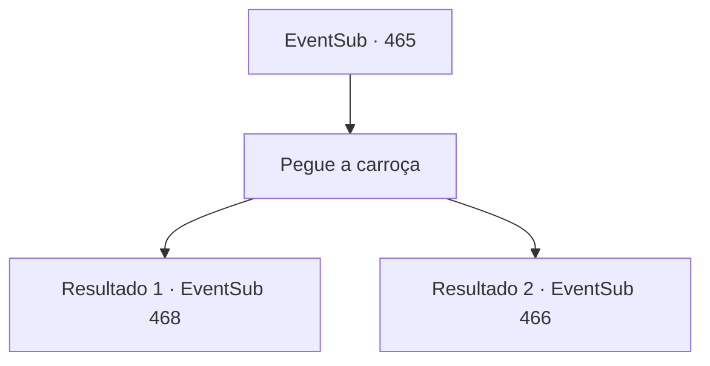

# Eventos secundários · 465

[Índice da tabela](index.md) · [Índice geral](../index.md)

ID: `pt:EventSub:465` · Fonte: `EventSub4` · Versão: 1.2.47.

Mapeamento estático dos arquivos; a disponibilidade e a execução dependem do estado da run.

## Texto do evento

Você volta para Antitikarr. E lá, você encontra uma caravana com muitas carroças agrupadas sob uma bandeira com um padrão de escorpião preto. Um dos membros da caravana reconhece você e cumprimenta você. 

 "Oh, você é {1}. Prazer em conhecê-lo. Ouvi falar de você. Meu nome é 'Mansa'. Por aqui, por favor."

 Ele mostra a você um carrinho cheio de coisas brilhantes de todos os tipos. 

 "Esta é a isca para pegar o dragão. Eu até empresto um camelo para puxar essa carroça. E..."

 Revirando sua bolsa, Mansa tira um mapa e o desdobra. 

 "Aqui, é suposto ser o covil do Dragão Azul. Vou torcer por você e desejar-lhe sorte."


## Dados de entrada

```json
{
  "id": 465,
  "grade": 1,
  "subEvent": "",
  "required": "12_9_2|1_2_50"
}
```

## Mapa das escolhas



## Escolhas e resultados

### Escolha 1

Pegue a carroça

Requisitos e outros campos da escolha:

```json
{
  "required": ""
}
```

#### Resultado 1.1

Você dirige a carroça para a área onde o Dragão Azul foi visto pela última vez. A brisa arenosa e o calor do Grande Deserto te dão as boas-vindas. 

 Não demora muito depois de entrar no deserto no camelo, todo o seu corpo está encharcado de suor. Você procura por sombra, mas não vê um lugar para escapar do sol. É exatamente nesse momento que algo lança uma grande sombra sobre você. E logo em seguida, um dragão com escamas azuis pousa diante de você. 

 "Krrrr... Você é irritante!"

 Você não sabe por que, mas ele já está muito bravo com você.

Continuação registrada: [Evento 468](0468.md) na mesma tabela.

```json
{
  "required": "18_446_2",
  "chance": "1",
  "nextEvent": 468,
  "type": 2,
  "reward": ""
}
```

#### Resultado 1.2

Você dirige a carroça para a área onde o Dragão Azul foi visto pela última vez. A brisa arenosa e o calor do Grande Deserto te recebem. 

 Você monta o camelo puxando a carroça para um vale cercado por paredes de rochas vermelhas. O vento quente sopra pelos vales, elevando ainda mais a temperatura do seu corpo. De repente, flechas voam em direção à sua carroça.

Continuação registrada: [Evento 466](0466.md) na mesma tabela.

```json
{
  "required": "5_446_2",
  "chance": "1",
  "nextEvent": 466,
  "type": 2,
  "reward": ""
}
```

## Referências que chegam a este evento

Nenhum `nextEvent` positivo da mesma tabela aponta para este nó. Isso não prova que seja inacessível: sorteio e estado de história podem selecioná-lo.

