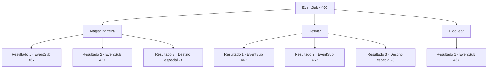

# Eventos secundários · 466

[Índice da tabela](index.md) · [Índice geral](../index.md)

ID: `pt:EventSub:466` · Fonte: `EventSub4` · Versão: 1.2.47.

Mapeamento estático dos arquivos; a disponibilidade e a execução dependem do estado da run.

## Texto do evento

*Sem texto no arquivo.*

## Dados de entrada

```json
{
  "id": 466,
  "grade": 1,
  "subEvent": "",
  "required": ""
}
```

## Mapa das escolhas



## Escolhas e resultados

### Escolha 1

Magia: Barreira

Requisitos e outros campos da escolha:

```json
{
  "required": "20_0_2|1_1_2"
}
```

#### Resultado 1.1

Você cria uma barreira e bloqueia as flechas que estão vindo. Seus atacantes saltam de trás das rochas no vale. Eles são assassinos envoltos em panos pretos. 

 "Mate-os!"

 Quando um deles grita, todos saltam em sua direção em uníssono.

Continuação registrada: [Evento 467](0467.md) na mesma tabela.

```json
{
  "required": "",
  "chance": "1|0_7_1|0_12_1",
  "nextEvent": 467,
  "type": 0,
  "reward": "6_3_48|0_1_-1",
  "place": 5
}
```

#### Resultado 1.2

Você conjura a barreira e tenta parar as flechas, mas sua concentração é quebrada. Uma flecha atinge seu antebraço, fazendo você rolar para fora do camelo. Seus atacantes saltam de trás das rochas no vale. Eles são assassinos envoltos em panos pretos. 

 "Mate-os!"

 Quando um deles grita, todos eles saltam em sua direção em uníssono.

Continuação registrada: [Evento 467](0467.md) na mesma tabela.

```json
{
  "required": "1_0_2",
  "chance": "22",
  "nextEvent": 467,
  "type": 1,
  "reward": "6_3_48|0_0_-1|0_1_-1",
  "place": 5
}
```

#### Resultado 1.3

Você conjura a barreira e tenta parar as flechas, mas sua concentração é quebrada. Uma flecha atinge seu antebraço, fazendo você rolar para fora do camelo.

Continuação registrada: [Destino especial `-3`](../destinos-especiais.md).

```json
{
  "required": "2_0_2",
  "chance": "22",
  "nextEvent": -3,
  "type": 1,
  "reward": "0_0_-1|0_1_-1"
}
```

### Escolha 2

Desviar

Requisitos e outros campos da escolha:

```json
{
  "required": ""
}
```

#### Resultado 2.1

Você se esquiva dos flechas voando. Seus atacantes saltam de trás das rochas no vale. Eles são assassinos envoltos em panos pretos. 

 "Mate-os!"

 Quando um deles grita, todos eles saltam em sua direção ao mesmo tempo.

Continuação registrada: [Evento 467](0467.md) na mesma tabela.

```json
{
  "required": "",
  "chance": "1|0_6_1",
  "nextEvent": 467,
  "type": 0,
  "reward": "6_3_48",
  "place": 5
}
```

#### Resultado 2.2

Você tenta se esquivar das flechas voando. Mas uma flecha atinge seu antebraço, fazendo você rolar para fora do camelo. Seus atacantes saltam de trás das rochas no vale. Eles são assassinos envoltos em panos pretos. 

 "Mate-os!"

 Quando um deles grita, todos saltam em sua direção ao mesmo tempo.

Continuação registrada: [Evento 467](0467.md) na mesma tabela.

```json
{
  "required": "1_0_2",
  "chance": "16",
  "nextEvent": 467,
  "type": 1,
  "reward": "6_3_48|0_0_-1",
  "place": 5
}
```

#### Resultado 2.3

Você tenta se esquivar das flechas voando. Mas uma flecha atinge seu antebraço, fazendo você rolar para fora do camelo. Você bate no chão tão forte que nunca mais se levanta novamente.

Continuação registrada: [Destino especial `-3`](../destinos-especiais.md).

```json
{
  "required": "2_0_2",
  "chance": "16",
  "nextEvent": -3,
  "type": 1,
  "reward": "0_0_-1"
}
```

### Escolha 3

Bloquear

Requisitos e outros campos da escolha:

```json
{
  "required": "20_9_1"
}
```

#### Resultado 3.1

Você bloqueia todas as flechas que vêm em sua direção. Seus atacantes saltam de trás das rochas no vale. Eles são assassinos envoltos em panos pretos. 

 "Mate-os!"

 Quando um deles grita, todos saltam em sua direção em uníssono.

Continuação registrada: [Evento 467](0467.md) na mesma tabela.

```json
{
  "required": "",
  "chance": "1",
  "nextEvent": 467,
  "type": 2,
  "reward": "6_3_48",
  "place": 5
}
```

## Referências que chegam a este evento

- [Evento 465 · escolha 1 · resultado 2](0465.md#escolha-1)
