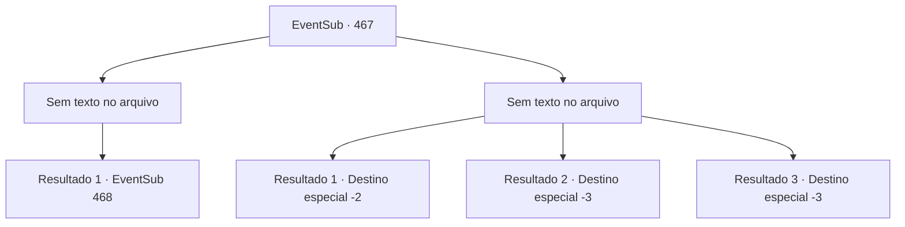

# Eventos secundários · 467

[Índice da tabela](index.md) · [Índice geral](../index.md)

ID: `pt:EventSub:467` · Fonte: `EventSub4` · Versão: 1.2.47.

Mapeamento estático dos arquivos; a disponibilidade e a execução dependem do estado da run.

## Texto do evento

*Sem texto no arquivo.*

## Dados de entrada

```json
{
  "id": 467,
  "grade": 1,
  "subEvent": "",
  "required": ""
}
```

## Mapa das escolhas



## Escolhas e resultados

### Escolha 1

*Sem texto no arquivo; o papel dessa opção depende da interface do jogo.*

Requisitos e outros campos da escolha:

```json
{
  "required": ""
}
```

#### Resultado 1.1

Você derruba todos os assassinos. Você se aproxima de um deles e pergunta quem os ordenou a te atacar. O assassino ri de você. 

 "Hahaha! Você é burro... Acha que vou responder isso?"

 Então ele morde algo, espuma pela boca e cai. Você deixa o corpo mole dele e volta para a carroça. Durante a luta, o camelo fugiu. Eventualmente, você puxa o carrinho sozinho e segue em direção ao covil do Dragão Azul. 

 Assim que você consegue tirar a carroça do vale, algo projeta uma sombra enorme sobre você. E logo em seguida, um dragão com escamas azuis pousa diante de você. 

 "Krrrr... Você é irritante!"

 Você não sabe por que, mas ele já está muito bravo.

Continuação registrada: [Evento 468](0468.md) na mesma tabela.

```json
{
  "required": "",
  "chance": "1",
  "nextEvent": 468,
  "type": 2,
  "reward": ""
}
```

### Escolha 2

*Sem texto no arquivo; o papel dessa opção depende da interface do jogo.*

Requisitos e outros campos da escolha:

```json
{
  "required": ""
}
```

#### Resultado 2.1

Você consegue escapar dos ataques dos assassinos. O camelo que estava puxando seu carrinho fugiu durante a luta. Você rouba um camelo que presume pertencer a um dos assassinos. Você consegue fugir com sucesso deles. No entanto, agora você não poderá encontrar o dragão que te trouxe até aqui em primeiro lugar.

Continuação registrada: [Destino especial `-2`](../destinos-especiais.md).

```json
{
  "required": "1_0_2|1_1_2",
  "chance": "1",
  "nextEvent": -2,
  "type": 2,
  "reward": "12_9_-1|0_0_-1|0_1_-1"
}
```

#### Resultado 2.2

Uma adaga voa e se crava em seu tornozelo. A dor intensa faz você cair de joelhos. Então outra adaga voa em sua direção e corta sua garganta. 

 "É melhor você não ameaçar os comerciantes da próxima vez. Se é que haverá uma próxima vez para você."

 Enquanto os assassinos zombam de você, sua consciência desaparece na escuridão.

Continuação registrada: [Destino especial `-3`](../destinos-especiais.md).

```json
{
  "required": "2_0_2",
  "chance": "1",
  "nextEvent": -3,
  "type": 2,
  "reward": "0_0_-1|0_1_-1"
}
```

#### Resultado 2.3

Uma adaga voa e se crava em seu tornozelo. A dor intensa faz você cair de joelhos. Então outra adaga voa em sua direção e corta sua garganta. 

 "É melhor você não ameaçar os comerciantes da próxima vez. Se é que haverá uma próxima vez para você."

 Enquanto os assassinos zombam de você, sua consciência desaparece na escuridão.

Continuação registrada: [Destino especial `-3`](../destinos-especiais.md).

```json
{
  "required": "2_1_2",
  "chance": "1",
  "nextEvent": -3,
  "type": 2,
  "reward": "0_0_-1|0_1_-1"
}
```

## Referências que chegam a este evento

- [Evento 466 · escolha 1 · resultado 1](0466.md#escolha-1)
- [Evento 466 · escolha 1 · resultado 2](0466.md#escolha-1)
- [Evento 466 · escolha 2 · resultado 1](0466.md#escolha-2)
- [Evento 466 · escolha 2 · resultado 2](0466.md#escolha-2)
- [Evento 466 · escolha 3 · resultado 1](0466.md#escolha-3)
