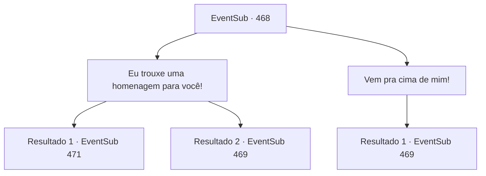

# Eventos secundários · 468

[Índice da tabela](index.md) · [Índice geral](../index.md)

ID: `pt:EventSub:468` · Fonte: `EventSub4` · Versão: 1.2.47.

Mapeamento estático dos arquivos; a disponibilidade e a execução dependem do estado da run.

## Texto do evento

*Sem texto no arquivo.*

## Dados de entrada

```json
{
  "id": 468,
  "grade": 1,
  "subEvent": "",
  "required": ""
}
```

## Mapa das escolhas



## Escolhas e resultados

### Escolha 1

Eu trouxe uma homenagem para você!

Requisitos e outros campos da escolha:

```json
{
  "required": ""
}
```

#### Resultado 1.1

Você oferece a carroça ao Dragão Azul. A carroça cheia de objetos brilhantes chama a atenção do Dragão Azul. O Dragão Azul olha para sua oferenda e responde com um cheiro de satisfação. 

 "Bom. Que negócio vocês têm para pisar no território de Ternach?"


Continuação registrada: [Evento 471](0471.md) na mesma tabela.

```json
{
  "required": "18_446_2",
  "chance": "1",
  "nextEvent": 471,
  "type": 2,
  "reward": ""
}
```

#### Resultado 1.2

Você oferece a carroça ao Dragão Azul. A carroça cheia de objetos brilhantes chama a atenção do Dragão Azul. O Dragão Azul olha para sua homenagem e grita com raiva. 

 "Tudo isso é lixo! Isso é uma homenagem? Vocês estão brincando comigo?"

 Um raio cai do céu seco enquanto o Dragão Azul ruge e abre suas asas.

Continuação registrada: [Evento 469](0469.md) na mesma tabela.

```json
{
  "required": "5_446_2",
  "chance": "1",
  "nextEvent": 469,
  "type": 2,
  "reward": "6_0_157|5_446_3",
  "place": 5
}
```

### Escolha 2

Vem pra cima de mim!

Requisitos e outros campos da escolha:

```json
{
  "required": ""
}
```

#### Resultado 2.1

No seu grito corajoso, o Dragão Azul explode em uma gargalhada. 

 "Khahaha!!! Todos vocês aventureiros praticam essas falas juntos? Sua coragem é divertida, mas vou transformar todos vocês em carvão como os outros!"

 Um raio cai do céu seco enquanto o Dragão Azul ruge e abre suas asas.

Continuação registrada: [Evento 469](0469.md) na mesma tabela.

```json
{
  "required": "",
  "chance": "1",
  "nextEvent": 469,
  "type": 2,
  "reward": "6_0_157",
  "place": 5
}
```

## Referências que chegam a este evento

- [Evento 465 · escolha 1 · resultado 1](0465.md#escolha-1)
- [Evento 467 · escolha 1 · resultado 1](0467.md#escolha-1)
