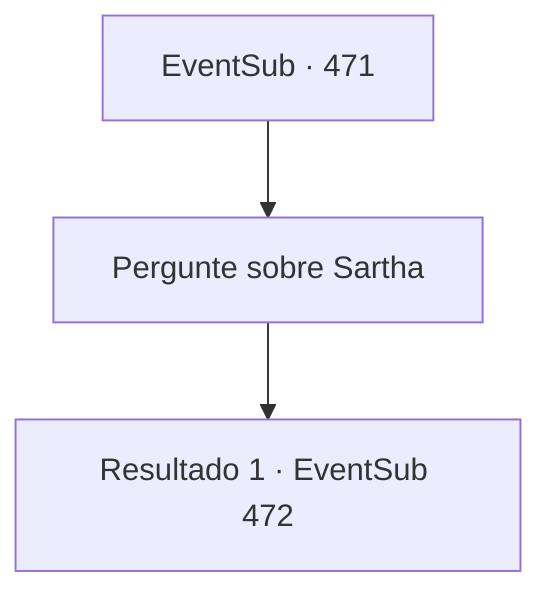

# Eventos secundários · 471

[Índice da tabela](index.md) · [Índice geral](../index.md)

ID: `pt:EventSub:471` · Fonte: `EventSub4` · Versão: 1.2.47.

Mapeamento estático dos arquivos; a disponibilidade e a execução dependem do estado da run.

## Texto do evento

*Sem texto no arquivo.*

## Dados de entrada

```json
{
  "id": 471,
  "grade": 1,
  "subEvent": "",
  "required": ""
}
```

## Mapa das escolhas



## Escolhas e resultados

### Escolha 1

Pergunte sobre Sartha

Requisitos e outros campos da escolha:

```json
{
  "required": ""
}
```

#### Resultado 1.1

Ternach responde com uma expressão de nojo. 

 "Os anões vieram me procurar, huh, eles fizeram um alvoroço por deixar Sartha ir..."

 O dragão suspira, te agarra e a carroça, e voa para o céu. Você não sabe para onde está indo enquanto o dragão corta o ar. 

 Logo depois, você chega em uma enorme duna. Ternach bate suas asas, e a areia é soprada, revelando uma caverna de pedra que estava enterrada sob a duna. 

 "Vamos lá."


Continuação registrada: [Evento 472](0472.md) na mesma tabela.

```json
{
  "required": "",
  "chance": "1",
  "nextEvent": 472,
  "type": 2,
  "reward": ""
}
```

## Referências que chegam a este evento

- [Evento 468 · escolha 1 · resultado 1](0468.md#escolha-1)
