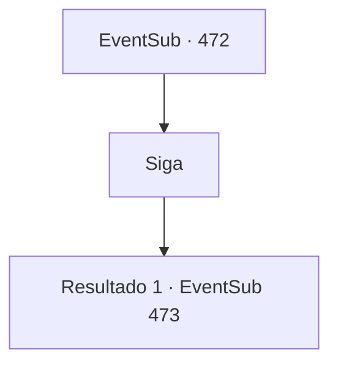

# Eventos secundários · 472

[Índice da tabela](index.md) · [Índice geral](../index.md)

ID: `pt:EventSub:472` · Fonte: `EventSub4` · Versão: 1.2.47.

Mapeamento estático dos arquivos; a disponibilidade e a execução dependem do estado da run.

## Texto do evento

*Sem texto no arquivo.*

## Dados de entrada

```json
{
  "id": 472,
  "grade": 1,
  "subEvent": "",
  "required": ""
}
```

## Mapa das escolhas



## Escolhas e resultados

### Escolha 1

Siga

Requisitos e outros campos da escolha:

```json
{
  "required": ""
}
```

#### Resultado 1.1

Você segue Ternach para a caverna. A caverna de pedra é vasta. O chão está coberto de coisas brilhantes como prata e ouro, joias, armaduras, coroas, espadas e escudos. Ternach vai para um canto do covil e tira algo de um poço. |drawing_sartha| É uma mulher anã com sobrancelhas escuras, corpo rechonchudo e um impressionante bigode. Ela olha para você com olhos verde-pálidos. E ela diz com um grande sorriso. 

 "Ha ha! Finalmente, meu pai enviou alguém para resgatar a Lady Sarta de Radania!"


Continuação registrada: [Evento 473](0473.md) na mesma tabela.

```json
{
  "required": "",
  "chance": "1",
  "nextEvent": 473,
  "type": 2,
  "reward": ""
}
```

## Referências que chegam a este evento

- [Evento 471 · escolha 1 · resultado 1](0471.md#escolha-1)
