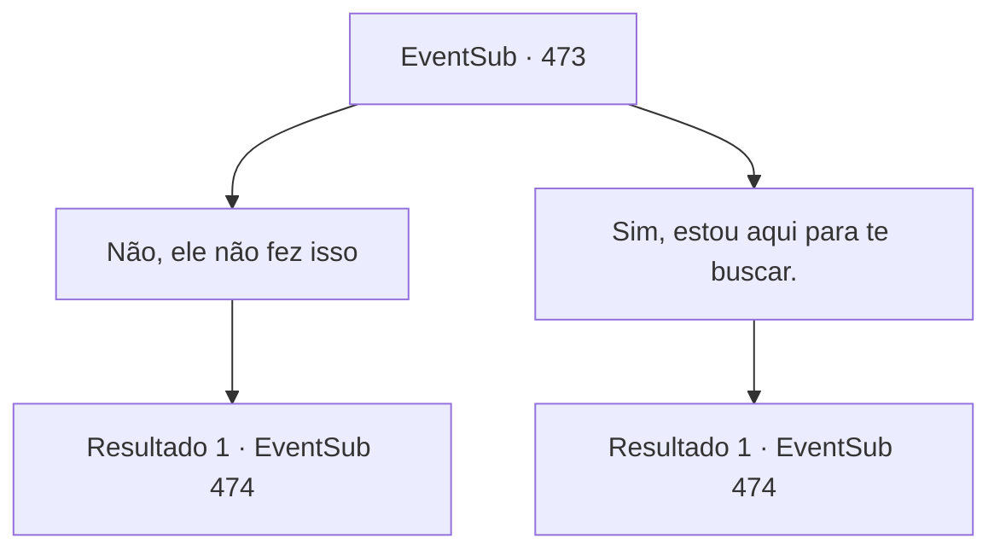

# Eventos secundários · 473

[Índice da tabela](index.md) · [Índice geral](../index.md)

ID: `pt:EventSub:473` · Fonte: `EventSub4` · Versão: 1.2.47.

Mapeamento estático dos arquivos; a disponibilidade e a execução dependem do estado da run.

## Texto do evento

*Sem texto no arquivo.*

## Dados de entrada

```json
{
  "id": 473,
  "grade": 1,
  "subEvent": "",
  "required": ""
}
```

## Mapa das escolhas



## Escolhas e resultados

### Escolha 1

Não, ele não fez isso

Requisitos e outros campos da escolha:

```json
{
  "required": ""
}
```

#### Resultado 1.1

Você diz a Sartha que não é o caso. Então Ternach questiona você, inclinando a cabeça. 

 "Hmm... Sério? Não é esse o anão que vocês estavam procurando?"

 Você balança a cabeça e repete que não está aqui por Sartha. O dragão assente. Sartha grita urgentemente. 

 "Sa, me salve! Meu pai irá recompensá-lo!"

 Ternach te adverte sem tentar esconder seu descontentamento. É melhor você não tentar levar Sarta.

Continuação registrada: [Evento 474](0474.md) na mesma tabela.

```json
{
  "required": "",
  "chance": "1",
  "nextEvent": 474,
  "type": 2,
  "reward": ""
}
```

### Escolha 2

Sim, estou aqui para te buscar.

Requisitos e outros campos da escolha:

```json
{
  "required": ""
}
```

#### Resultado 2.1

Quando Sartha ouve sua resposta, ela sorri, No entanto, Ternach faz uma expressão descontente. 

 "Não está pensando em levar essa criança, está? Ela tem sido boa para Ternach. Os tributos estão se tornando mais valiosos desde que a capturei."

 O Dragão Azul te encara. Ele está prestes a avançar diretamente em você.

Continuação registrada: [Evento 474](0474.md) na mesma tabela.

```json
{
  "required": "",
  "chance": "1",
  "nextEvent": 474,
  "type": 2,
  "reward": ""
}
```

## Referências que chegam a este evento

- [Evento 472 · escolha 1 · resultado 1](0472.md#escolha-1)
