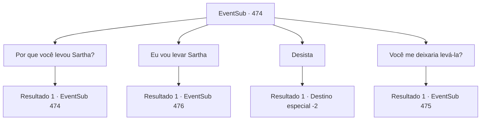

# Eventos secundários · 474

[Índice da tabela](index.md) · [Índice geral](../index.md)

ID: `pt:EventSub:474` · Fonte: `EventSub4` · Versão: 1.2.47.

Mapeamento estático dos arquivos; a disponibilidade e a execução dependem do estado da run.

## Texto do evento

*Sem texto no arquivo.*

## Dados de entrada

```json
{
  "id": 474,
  "grade": 1,
  "subEvent": "",
  "required": ""
}
```

## Mapa das escolhas



## Escolhas e resultados

### Escolha 1

Por que você levou Sartha?

Requisitos e outros campos da escolha:

```json
{
  "required": "5_447_0"
}
```

#### Resultado 1.1

O Dragão Azul responde à sua pergunta como se a resposta fosse óbvia. 

 "Os anões são bons em fazer coisas. Se eu pudesse fazê-los trabalhar para mim, não seria capaz de encher minha casa com tesouros melhores?"

 Ternach encontrou algo que os anões reverenciavam: Sarta. E depois que o dragão a levou, os anões foram obrigados a obedecer a Ternach.

Continuação registrada: [Evento 474](0474.md) na mesma tabela.

```json
{
  "required": "",
  "chance": "1",
  "nextEvent": 474,
  "type": 2,
  "reward": "5_447_1"
}
```

### Escolha 2

Eu vou levar Sartha

Requisitos e outros campos da escolha:

```json
{
  "required": ""
}
```

#### Resultado 2.1

Você diz que vai levar Sartha de volta. Ternach rosna em resposta. 

 "Bem então, por que vocês não a levam à força!"

 Um raio cai enquanto o dragão ruge.

Continuação registrada: [Evento 476](0476.md) na mesma tabela.

```json
{
  "required": "",
  "chance": "1",
  "nextEvent": 476,
  "type": 2,
  "reward": "6_0_157",
  "place": 6
}
```

### Escolha 3

Desista

Requisitos e outros campos da escolha:

```json
{
  "required": ""
}
```

#### Resultado 3.1

Você decide não levar Sartha. Ternach responde com um aceno. 

 "Boa ideia. Agora vá."

 Você sai da caverna do dragão, fingindo não ouvir o choro lamentoso de Sartha.

Continuação registrada: [Destino especial `-2`](../destinos-especiais.md).

```json
{
  "required": "",
  "chance": "1",
  "nextEvent": -2,
  "type": 2,
  "reward": "12_9_-1"
}
```

### Escolha 4

Você me deixaria levá-la?

Requisitos e outros campos da escolha:

```json
{
  "required": ""
}
```

#### Resultado 4.1

Ternach responde à sua pergunta com uma carranca. 

 "Hmm... Se vocês querem levar esse garoto, vão ter que me dar mais tributo. Vamos ver... 10.000 ouro devem resolver."


Continuação registrada: [Evento 475](0475.md) na mesma tabela.

```json
{
  "required": "",
  "chance": "1",
  "nextEvent": 475,
  "type": 2,
  "reward": ""
}
```

## Referências que chegam a este evento

- [Evento 473 · escolha 1 · resultado 1](0473.md#escolha-1)
- [Evento 473 · escolha 2 · resultado 1](0473.md#escolha-2)
- [Evento 474 · escolha 1 · resultado 1](0474.md#escolha-1)
