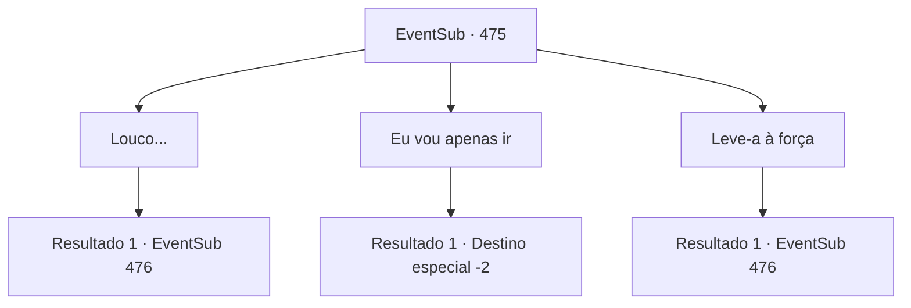

# Eventos secundários · 475

[Índice da tabela](index.md) · [Índice geral](../index.md)

ID: `pt:EventSub:475` · Fonte: `EventSub4` · Versão: 1.2.47.

Mapeamento estático dos arquivos; a disponibilidade e a execução dependem do estado da run.

## Texto do evento

*Sem texto no arquivo.*

## Dados de entrada

```json
{
  "id": 475,
  "grade": 1,
  "subEvent": "",
  "required": ""
}
```

## Mapa das escolhas



## Escolhas e resultados

### Escolha 1

Louco...

Requisitos e outros campos da escolha:

```json
{
  "required": "2_14_10"
}
```

#### Resultado 1.1

Você acidentalmente expressa seus pensamentos. Ternach rosna para você. 

 "Você está confiante? Tente escapar com sua própria força."

 Um raio cai enquanto o dragão ruge.

Continuação registrada: [Evento 476](0476.md) na mesma tabela.

```json
{
  "required": "",
  "chance": "1",
  "nextEvent": 476,
  "type": 2,
  "reward": "6_0_157",
  "place": 6
}
```

### Escolha 2

Eu vou apenas ir

Requisitos e outros campos da escolha:

```json
{
  "required": "1_14_10"
}
```

#### Resultado 2.1

Você se despede calmamente do dragão. Ternak te acompanha com um aceno. 

 "Vá em frente."

 Você sai da caverna do dragão, fingindo não ouvir o lamento triste de Sartha.

Continuação registrada: [Destino especial `-2`](../destinos-especiais.md).

```json
{
  "required": "",
  "chance": "1",
  "nextEvent": -2,
  "type": 2,
  "reward": "12_9_-1"
}
```

### Escolha 3

Leve-a à força

Requisitos e outros campos da escolha:

```json
{
  "required": ""
}
```

#### Resultado 3.1

Você diz que vai levar Sartha sem pagar. Ternach rosna de volta. 

 "Bem então, por que vocês não a levam à força!"

 Um raio cai enquanto o dragão ruge.

Continuação registrada: [Evento 476](0476.md) na mesma tabela.

```json
{
  "required": "",
  "chance": "1",
  "nextEvent": 476,
  "type": 2,
  "reward": "6_0_157",
  "place": 6
}
```

## Referências que chegam a este evento

- [Evento 474 · escolha 4 · resultado 1](0474.md#escolha-4)
