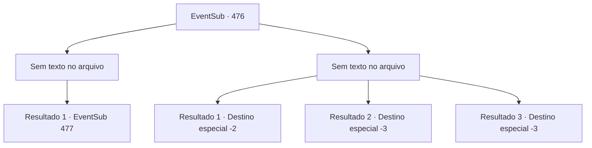

# Eventos secundários · 476

[Índice da tabela](index.md) · [Índice geral](../index.md)

ID: `pt:EventSub:476` · Fonte: `EventSub4` · Versão: 1.2.47.

Mapeamento estático dos arquivos; a disponibilidade e a execução dependem do estado da run.

## Texto do evento

*Sem texto no arquivo.*

## Dados de entrada

```json
{
  "id": 476,
  "grade": 1,
  "subEvent": "",
  "required": ""
}
```

## Mapa das escolhas



## Escolhas e resultados

### Escolha 1

*Sem texto no arquivo; o papel dessa opção depende da interface do jogo.*

Requisitos e outros campos da escolha:

```json
{
  "required": ""
}
```

#### Resultado 1.1


 "Cof...! Ah... Não posso acreditar que perdi para um humano! Isso não pode estar acontecendo!"

 Você derrotou o Dragão Azul. Mas ele não admite a derrota. Ele range os dentes e corre em sua direção novamente.

Continuação registrada: [Evento 477](0477.md) na mesma tabela.

```json
{
  "required": "",
  "chance": "1",
  "nextEvent": 477,
  "type": 2,
  "reward": "6_2_157",
  "place": 6
}
```

### Escolha 2

*Sem texto no arquivo; o papel dessa opção depende da interface do jogo.*

Requisitos e outros campos da escolha:

```json
{
  "required": ""
}
```

#### Resultado 2.1


 "Hahaha! Sim, fuja! Que fraco!"

 Você foge do Dragão Azul. Ao ver você escapar, o dragão explode em risadas. Você deixa a caverna do dragão, fingindo não ouvir o choro lamentoso de Sartha.

Continuação registrada: [Destino especial `-2`](../destinos-especiais.md).

```json
{
  "required": "1_0_2|1_1_2",
  "chance": "1",
  "nextEvent": -2,
  "type": 2,
  "reward": "12_9_-1|0_0_-1|0_1_-1"
}
```

#### Resultado 2.2

Oi pessoal! Correntes elétricas intensas se reúnem ao redor dos chifres de Ternach. E no próximo momento, ele as dispara em sua direção. Você não consegue desviar a tempo e se torna um monte de carvão preto.

Continuação registrada: [Destino especial `-3`](../destinos-especiais.md).

```json
{
  "required": "2_0_2",
  "chance": "1",
  "nextEvent": -3,
  "type": 2,
  "reward": "0_0_-1|0_1_-1"
}
```

#### Resultado 2.3

Oi pessoal! Correntes elétricas intensas se reúnem ao redor dos chifres de Ternach. E no próximo momento, ele as dispara em sua direção. Você não consegue desviar a tempo e se torna um monte de carvão preto.

Continuação registrada: [Destino especial `-3`](../destinos-especiais.md).

```json
{
  "required": "2_1_2",
  "chance": "1",
  "nextEvent": -3,
  "type": 2,
  "reward": "0_0_-1|0_1_-1"
}
```

## Referências que chegam a este evento

- [Evento 474 · escolha 2 · resultado 1](0474.md#escolha-2)
- [Evento 475 · escolha 1 · resultado 1](0475.md#escolha-1)
- [Evento 475 · escolha 3 · resultado 1](0475.md#escolha-3)
- [Evento 479 · escolha 1 · resultado 1](0479.md#escolha-1)
- [Evento 479 · escolha 1 · resultado 2](0479.md#escolha-1)
- [Evento 479 · escolha 2 · resultado 1](0479.md#escolha-2)
- [Evento 479 · escolha 2 · resultado 2](0479.md#escolha-2)
- [Evento 479 · escolha 2 · resultado 3](0479.md#escolha-2)
