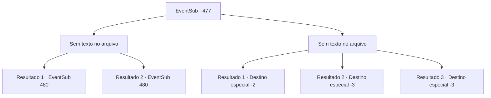

# Eventos secundários · 477

[Índice da tabela](index.md) · [Índice geral](../index.md)

ID: `pt:EventSub:477` · Fonte: `EventSub4` · Versão: 1.2.47.

Mapeamento estático dos arquivos; a disponibilidade e a execução dependem do estado da run.

## Texto do evento

*Sem texto no arquivo.*

## Dados de entrada

```json
{
  "id": 477,
  "grade": 1,
  "subEvent": "",
  "required": ""
}
```

## Mapa das escolhas



## Escolhas e resultados

### Escolha 1

*Sem texto no arquivo; o papel dessa opção depende da interface do jogo.*

Requisitos e outros campos da escolha:

```json
{
  "required": ""
}
```

#### Resultado 1.1

O Dragão Azul sucumbe ao seu ataque. Ele se transforma em um ser humano e cai de joelhos. A humana tem cabelos azuis sedosos quase até os tornozelos, um nariz e mandíbula afiados e olhos que brilham azul como safiras. 

 "Eu... Ah, perdido, mano. O que vocês querem de mim?"

 Ternach pergunta mais gentilmente do que antes, limpando o sangue ao redor de sua boca.

Continuação registrada: [Evento 480](0480.md) na mesma tabela.

```json
{
  "required": "11_0_0",
  "chance": "1",
  "nextEvent": 480,
  "type": 2,
  "reward": ""
}
```

#### Resultado 1.2

O Dragão Azul sucumbe ao seu ataque. Ele se transforma em um ser humano e cai de joelhos. O humano tem cabelos azuis sedosos, um nariz afiado e uma mandíbula definida, e olhos que brilham azul como safiras. 

 "Eu... Ah, perdido, irmã. O que vocês querem de mim?"

 Ternach pergunta mais gentilmente do que antes, limpando o sangue ao redor de sua boca.

Continuação registrada: [Evento 480](0480.md) na mesma tabela.

```json
{
  "required": "11_0_1",
  "chance": "1",
  "nextEvent": 480,
  "type": 2,
  "reward": ""
}
```

### Escolha 2

*Sem texto no arquivo; o papel dessa opção depende da interface do jogo.*

Requisitos e outros campos da escolha:

```json
{
  "required": ""
}
```

#### Resultado 2.1

Após investir contra você novamente, o Dragão Azul te derrota. Ele explode em risadas e grita. 

 "Hahaha! Saia daqui rapidamente!!"

 O Dragão Azul levanta suas asas e rosna, e você rapidamente se retira.

Continuação registrada: [Destino especial `-2`](../destinos-especiais.md).

```json
{
  "required": "1_0_2|1_1_2",
  "chance": "1",
  "nextEvent": -2,
  "type": 2,
  "reward": "12_9_-1|0_0_-1|0_1_-1"
}
```

#### Resultado 2.2

Oi pessoal! Correntes elétricas intensas se reúnem ao redor dos chifres de Ternach. E no próximo momento, ele as dispara em sua direção. Você não consegue desviar a tempo e se torna um monte de carvão preto.

Continuação registrada: [Destino especial `-3`](../destinos-especiais.md).

```json
{
  "required": "2_0_2",
  "chance": "1",
  "nextEvent": -3,
  "type": 2,
  "reward": "0_0_-1|0_1_-1"
}
```

#### Resultado 2.3

Oi pessoal! Correntes elétricas intensas se reúnem ao redor dos chifres de Ternach. E no próximo momento, ele as dispara em sua direção. Você não consegue desviar a tempo e se torna um monte de carvão preto.

Continuação registrada: [Destino especial `-3`](../destinos-especiais.md).

```json
{
  "required": "2_1_2",
  "chance": "1",
  "nextEvent": -3,
  "type": 2,
  "reward": "0_0_-1|0_1_-1"
}
```

## Referências que chegam a este evento

- [Evento 476 · escolha 1 · resultado 1](0476.md#escolha-1)
