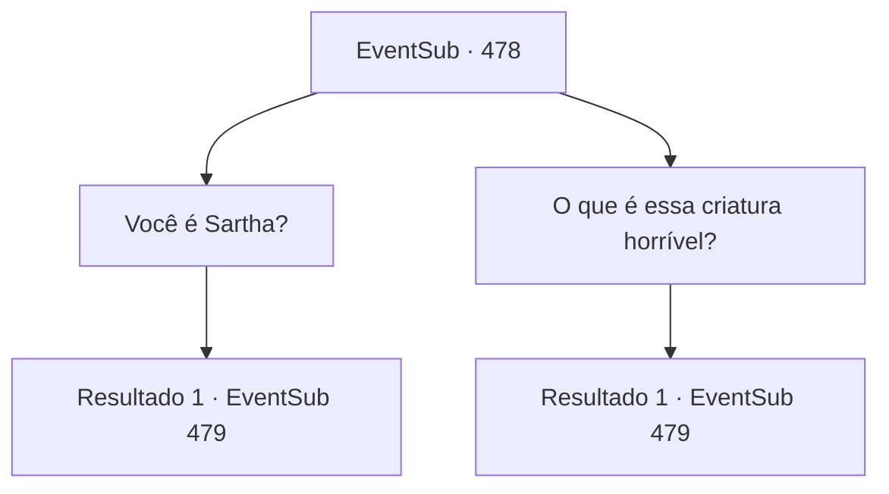

# Eventos secundários · 478

[Índice da tabela](index.md) · [Índice geral](../index.md)

ID: `pt:EventSub:478` · Fonte: `EventSub4` · Versão: 1.2.47.

Mapeamento estático dos arquivos; a disponibilidade e a execução dependem do estado da run.

## Texto do evento

*Sem texto no arquivo.*

## Dados de entrada

```json
{
  "id": 478,
  "grade": 1,
  "subEvent": "",
  "required": ""
}
```

## Mapa das escolhas



## Escolhas e resultados

### Escolha 1

Você é Sartha?

Requisitos e outros campos da escolha:

```json
{
  "required": ""
}
```

#### Resultado 1.1

Ela responde à sua pergunta com um aceno. 

 "Sim, sou Sartha, a senhora de Radania. Tenho uma ideia. Por que você não sai dessa cova, me carregando nas costas? O que você acha?"

 A forma como Sartha diz isso faz você se perguntar se ela acha que é feita de penas. Você olha para cima. A cova em que você está parece ter pelo menos 13 pés de profundidade.

Continuação registrada: [Evento 479](0479.md) na mesma tabela.

```json
{
  "required": "",
  "chance": "1",
  "nextEvent": 479,
  "type": 2,
  "reward": ""
}
```

### Escolha 2

O que é essa criatura horrível?

Requisitos e outros campos da escolha:

```json
{
  "required": ""
}
```

#### Resultado 2.1

Ela parece chocada com sua pergunta. 

 "O quê? Horrível...? Como você pode dizer isso para a dama de Radania... Ugh, nunca conheci alguém assim antes!"

 Ela estremece, mas continua falando. 

 "Este não é o momento para discutir sobre isso. Suba desta cova comigo nas suas costas."

 A forma como Sartha diz isso faz você se perguntar se ela acha que é feita de penas. Você olha para cima. A cova em que você está parece ter pelo menos 13 pés de profundidade.

Continuação registrada: [Evento 479](0479.md) na mesma tabela.

```json
{
  "required": "",
  "chance": "1",
  "nextEvent": 479,
  "type": 2,
  "reward": ""
}
```

## Referências que chegam a este evento

- [Evento 469 · escolha 2 · resultado 1](0469.md#escolha-2)
- [Evento 470 · escolha 2 · resultado 1](0470.md#escolha-2)
