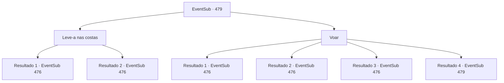

# Eventos secundários · 479

[Índice da tabela](index.md) · [Índice geral](../index.md)

ID: `pt:EventSub:479` · Fonte: `EventSub4` · Versão: 1.2.47.

Mapeamento estático dos arquivos; a disponibilidade e a execução dependem do estado da run.

## Texto do evento

*Sem texto no arquivo.*

## Dados de entrada

```json
{
  "id": 479,
  "grade": 1,
  "subEvent": "",
  "required": ""
}
```

## Mapa das escolhas



## Escolhas e resultados

### Escolha 1

Leve-a nas costas

Requisitos e outros campos da escolha:

```json
{
  "required": ""
}
```

#### Resultado 1.1

Você sobe pela parede do poço com Sartha nas costas. Assim que você se puxa para fora do poço com força sobre-humana, Sartha sussurra urgentemente. 

 "Essa é a nossa chance. Vamos fugir rapidamente."

 Mas enquanto ela está falando, o dragão aparece de um canto escuro da caverna. 

 "Hahaha! Vocês não desistem ainda?"

 Ele ri e ataca você com sua respiração de relâmpago.

Continuação registrada: [Evento 476](0476.md) na mesma tabela.

```json
{
  "required": "",
  "chance": "1|0_5_1",
  "nextEvent": 476,
  "type": 0,
  "reward": "6_0_157|5_448_1|5_449_1",
  "place": 6
}
```

#### Resultado 1.2

Você tenta escalar a parede do poço com Sartha nas costas. No entanto, é muito difícil para você. Sartha estala a língua e fala. 

 "Tsk... Como um aventureiro pode ser tão fraco? Suba nas minhas costas."

 Ela luta com você nas costas, mas consegue subir pela parede. Você tenta perguntar a ela se ela poderia ter saído sozinha o tempo todo. Mas então o dragão aparece de um canto escuro da caverna. 

 "Hahaha! Vocês não desistem ainda?"

 Ele ri e ataca você com seu sopro de relâmpago.

Continuação registrada: [Evento 476](0476.md) na mesma tabela.

```json
{
  "required": "",
  "chance": "22",
  "nextEvent": 476,
  "type": 1,
  "reward": "6_0_157|5_449_1",
  "place": 6
}
```

### Escolha 2

Voar

Requisitos e outros campos da escolha:

```json
{
  "required": "18_450_1"
}
```

#### Resultado 2.1

Você usa magia para sair do buraco com Sartha. Assim que você voa de volta ao topo, Sartha te instiga. 

 "Essa é nossa chance. Vamos fugir rapidamente."

 Mas enquanto ela está falando, o dragão aparece de um canto escuro da caverna. 

 "Hahaha! Vocês não desistem ainda?"

 Ele ri e te ataca com sua respiração de relâmpago.

Continuação registrada: [Evento 476](0476.md) na mesma tabela.

```json
{
  "required": "20_0_1|21_10_1",
  "chance": "1|0_7_1",
  "nextEvent": 476,
  "type": 0,
  "reward": "6_0_157|5_448_1|5_449_1",
  "place": 6
}
```

#### Resultado 2.2

Você tenta usar magia para sair do buraco com Sartha. No entanto, o feitiço falha e você cai de volta novamente. Sartha estala a língua e fala. 

 "Tsk... Apenas suba nas minhas costas."

 Ela luta com você em suas costas, mas consegue subir pela parede. Você tenta perguntar a ela se ela poderia ter subido sozinha o tempo todo. Mas então o dragão aparece de um canto escuro da caverna. 

 "Hahaha! Vocês não desistem ainda?"

 Ele ri e ataca você com sua respiração de relâmpago.

Continuação registrada: [Evento 476](0476.md) na mesma tabela.

```json
{
  "required": "20_0_1|21_10_1",
  "chance": "16",
  "nextEvent": 476,
  "type": 1,
  "reward": "6_0_157|5_449_1",
  "place": 6
}
```

#### Resultado 2.3

Você dá um passo no ar e sai do buraco com Sartha. Assim que você voa de volta para o topo, Sartha te incentiva. 

 "Essa é nossa chance. Vamos fugir rapidamente."

 Mas enquanto ela está falando, o dragão aparece de um canto escuro da caverna. 

 "Hahaha! Vocês não desistem ainda?"

 Ele ri e te ataca com sua respiração de relâmpago.

Continuação registrada: [Evento 476](0476.md) na mesma tabela.

```json
{
  "required": "20_10_1",
  "chance": "1",
  "nextEvent": 476,
  "type": 2,
  "reward": "6_0_157|5_448_1|5_449_1",
  "place": 6
}
```

#### Resultado 2.4

Você acha que seria bom simplesmente voar para fora do buraco. Mas você não tem uma maneira de fazer isso.

Continuação registrada: [Evento 479](0479.md) na mesma tabela.

```json
{
  "required": "21_0_1|21_10_1",
  "chance": "1",
  "nextEvent": 479,
  "type": 2,
  "reward": "5_450_1"
}
```

## Referências que chegam a este evento

- [Evento 478 · escolha 1 · resultado 1](0478.md#escolha-1)
- [Evento 478 · escolha 2 · resultado 1](0478.md#escolha-2)
- [Evento 479 · escolha 2 · resultado 4](0479.md#escolha-2)
