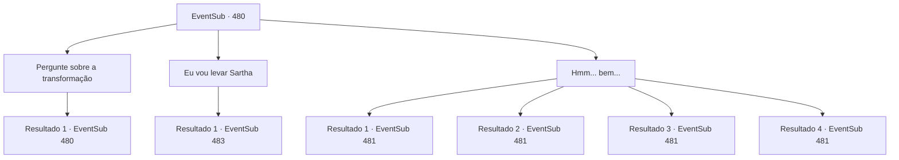

# Eventos secundários · 480

[Índice da tabela](index.md) · [Índice geral](../index.md)

ID: `pt:EventSub:480` · Fonte: `EventSub4` · Versão: 1.2.47.

Mapeamento estático dos arquivos; a disponibilidade e a execução dependem do estado da run.

## Texto do evento

*Sem texto no arquivo.*

## Dados de entrada

```json
{
  "id": 480,
  "grade": 1,
  "subEvent": "",
  "required": ""
}
```

## Mapa das escolhas



## Escolhas e resultados

### Escolha 1

Pergunte sobre a transformação

Requisitos e outros campos da escolha:

```json
{
  "required": "1_7_10|5_451_0"
}
```

#### Resultado 1.1

Você já ouviu falar de dragões metálicos se transformando em humanos, mas você nunca ouviu falar de um dragão cromático, como um dragão azul, se transformando em um ser humano. Ternach responde à sua pergunta com um suspiro. 

 "Um... um maldito dragão de latão disse... para me provocar, 'Vocês não conseguem fazer isso, certo?'. Então, eu encontrei um mago e aprendi."

 Ternach continua, compartilhando mais detalhes do que você havia perguntado. 

 "Eu aprendi a falar a língua humana com o mago. Eles eram de Wagon Mountain."


Continuação registrada: [Evento 480](0480.md) na mesma tabela.

```json
{
  "required": "",
  "chance": "1",
  "nextEvent": 480,
  "type": 2,
  "reward": "5_451_1"
}
```

### Escolha 2

Eu vou levar Sartha

Requisitos e outros campos da escolha:

```json
{
  "required": ""
}
```

#### Resultado 2.1

Quando você diz que está levando Sartha, Ternach assente. Sartha sorri como se soubesse desde o início que você a resgataria. 

 "Obrigado por me salvar. {1}. Eu não vou esquecer esse favor."

 Você deixa a caverna do dragão com Sartha. Enquanto vocês voltam para Antitikarr, o sol começa a se pôr atrás das montanhas a oeste, pintando o deserto de azul escuro. Então Sartha fala. 

 "Acho que ainda temos um longo caminho pela frente, então que tal chamarmos isso de uma noite?"


Continuação registrada: [Evento 483](0483.md) na mesma tabela.

```json
{
  "required": "",
  "chance": "1",
  "nextEvent": 483,
  "type": 2,
  "reward": ""
}
```

### Escolha 3

Hmm... bem...

Requisitos e outros campos da escolha:

```json
{
  "required": ""
}
```

#### Resultado 3.1

Você tira um momento para olhar para Ternach. Ternach parece estar pensativa quando ela de repente fala. 

 "Oh, é verdade. Agora que somos irmãos, vou te servir uma bebida."

 Ternach coloca o braço em volta dos seus ombros antes que você possa responder. Sartha fala de trás de você. 

 "Não... Você não deveria me resgatar?"

 Ternach rosna para ela. 

 "Você fica quieta."

 Então Ternach empurra Sartha de volta para o buraco. Ela revira sua pilha de lixo e encontra uma mesa, dois copos e um barril de álcool. Satisfeita, ela te entrega uma bebida antes de servir a sua própria. 

 "Saúde!"

 Três horas depois, Ternach está muito bêbada. Ela sorri, e você se pergunta se ela já esqueceu a briga que teve com você. 

 "Irmão, você gosta da Sartha, não é? Vendo que você está tentando resgatá-la."


Continuação registrada: [Evento 481](0481.md) na mesma tabela.

```json
{
  "required": "11_0_0|5_449_1",
  "chance": "1",
  "nextEvent": 481,
  "type": 2,
  "reward": ""
}
```

#### Resultado 3.2

Você tira um momento para olhar para Ternach. Ternach parece estar pensativo quando ele de repente fala. 

 "Oh, é verdade. Agora que somos irmão e irmã, vou te servir uma bebida."

 Ternach coloca o braço em volta dos seus ombros antes que você possa responder. Sartha fala de trás de você. 

 "Não... Você não deveria me resgatar?"

 Ternach rosna para ela. 

 "Você fica quieta."

 Então Ternach empurra Sartha de volta para o buraco. Ele revira sua pilha de lixo e encontra uma mesa, dois copos e um barril de álcool. Satisfeito, ele te entrega uma bebida antes de servir a sua própria. 

 "Saúde!"

 Três horas depois, Ternach está muito bêbado. Ele sorri, e você se pergunta se ele já esqueceu a briga que teve com você. 

 "Irmã, você gosta da Sartha, não é? Vendo que você está tentando resgatá-la."


Continuação registrada: [Evento 481](0481.md) na mesma tabela.

```json
{
  "required": "11_0_1|5_449_1",
  "chance": "1",
  "nextEvent": 481,
  "type": 2,
  "reward": ""
}
```

#### Resultado 3.3

Você tira um momento para olhar para Ternach. Ternach parece estar pensativa quando ela de repente fala. 

 "Oh, é verdade. Agora que somos irmãos, vou te servir uma bebida."

 Ternach se certifica de que Sartha está no poço. Então, ela revira sua pilha de lixo e encontra uma mesa, dois copos e um barril de álcool. Satisfeita, ela te entrega uma bebida antes de servir a sua própria. 

 "Saúde!"

 Três horas depois, Ternach está agora muito bêbada. Ela sorri, e você se pergunta se ela já esqueceu a briga que teve com você. 

 "Mano, você gosta da Sartha, não é? Vendo que você está tentando resgatá-la."


Continuação registrada: [Evento 481](0481.md) na mesma tabela.

```json
{
  "required": "11_0_0|18_449_1",
  "chance": "1",
  "nextEvent": 481,
  "type": 2,
  "reward": ""
}
```

#### Resultado 3.4

Você tira um momento para olhar para Ternach. Ternach parece estar pensativo quando ele de repente fala. 

 "Oh, é verdade. Agora que somos irmão e irmã, vou te servir uma bebida."

 Ternach se certifica de que Sartha está no poço. Então, ele revira sua pilha de lixo e encontra uma mesa, dois copos e um barril de álcool. Satisfeito, ele te entrega uma bebida antes de servir a sua própria. 

 "Saúde!"

 Três horas depois, Ternach está agora muito bêbado. Ele sorri, e você se pergunta se ele já esqueceu a briga que teve com você. 

 "Irmã, você gosta da Sartha, não é? Vendo que você está tentando resgatá-la."


Continuação registrada: [Evento 481](0481.md) na mesma tabela.

```json
{
  "required": "11_0_1|18_449_1",
  "chance": "1",
  "nextEvent": 481,
  "type": 2,
  "reward": ""
}
```

## Referências que chegam a este evento

- [Evento 477 · escolha 1 · resultado 1](0477.md#escolha-1)
- [Evento 477 · escolha 1 · resultado 2](0477.md#escolha-1)
- [Evento 480 · escolha 1 · resultado 1](0480.md#escolha-1)
