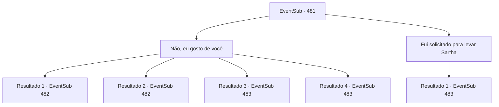

# Eventos secundários · 481

[Índice da tabela](index.md) · [Índice geral](../index.md)

ID: `pt:EventSub:481` · Fonte: `EventSub4` · Versão: 1.2.47.

Mapeamento estático dos arquivos; a disponibilidade e a execução dependem do estado da run.

## Texto do evento

*Sem texto no arquivo.*

## Dados de entrada

```json
{
  "id": 481,
  "grade": 1,
  "subEvent": "",
  "required": ""
}
```

## Mapa das escolhas



## Escolhas e resultados

### Escolha 1

Não, eu gosto de você

Requisitos e outros campos da escolha:

```json
{
  "required": "24_1_1"
}
```

#### Resultado 1.1

Ternach parece confusa, seus olhos se abrindo um pouco. Ela estende os braços e coloca as mãos em seus ombros. 

 "Bem... Primeiro de tudo, vamos verificar se somos compatíveis."

 Juntos, vocês têm uma 'conversa' áspera e primal com seus corpos. Quando terminam, todo o seu corpo está encharcado de suor. Ternach não está suando, mas parece ofegante. Quando ela exala, sua respiração é quente. 

 "Ufa... definitivamente somos compatíveis, mano."

 Ela estende a mão e te ajuda a levantar. Ela diz que vai te levar de volta de onde você veio. Então, Ternach volta à sua forma original e te diz para subir em suas costas.

Continuação registrada: [Evento 482](0482.md) na mesma tabela.

```json
{
  "required": "11_0_0",
  "chance": "1|0_13_1",
  "nextEvent": 482,
  "type": 0,
  "reward": "0_1_1|0_13_1"
}
```

#### Resultado 1.2

Ternach parece confuso, seus olhos se abrem um pouco mais. Ele estende os braços e coloca as mãos em seus ombros. 

 "Bem... Primeiro de tudo, vamos verificar se somos compatíveis."

 Juntos, vocês têm uma 'conversa' áspera e primal com seus corpos. Quando terminam, todo o seu corpo está encharcado de suor. Ternach não está suando, mas parece estar ofegante. Quando ele exala, sua respiração é quente. 

 "Ufa... definitivamente somos compatíveis, irmã."

 Ele estende a mão e ajuda você a levantar. Ele diz que vai te levar de volta de onde você veio. Então, Ternach volta à sua forma original e diz para você subir em suas costas.

Continuação registrada: [Evento 482](0482.md) na mesma tabela.

```json
{
  "required": "11_0_1",
  "chance": "1|0_13_1",
  "nextEvent": 482,
  "type": 0,
  "reward": "0_1_1|0_13_1"
}
```

#### Resultado 1.3

Ternach parece confusa, seus olhos se abrindo um pouco. Ela estende os braços e coloca as mãos em seus ombros. 

 "Bem... Primeiro de tudo, vamos verificar se somos compatíveis."

 Juntos, vocês têm uma 'conversa' áspera e primal com seus corpos. Quando terminam, todo o seu corpo está encharcado de suor. Ternach suspira e olha para você. 

 "Ufa... Cara. Acho que você não combina comigo. Apenas leve o anão ali."

 Você acaba resgatando Sartha do covil do dragão. Sartha olha para você e agradece. 

 "Você tem um estômago forte. Aquela coisa feia... Mm-hmm. De qualquer forma, obrigado por me salvar, {1}. Não vou esquecer esse favor."

 Enquanto vocês voltam para Antitikarr, o sol começa a se pôr atrás das montanhas a oeste, pintando o deserto de azul escuro. Então Sartha fala. 

 "Acho que ainda temos um longo caminho pela frente, então que tal chamarmos isso de uma noite?"


Continuação registrada: [Evento 483](0483.md) na mesma tabela.

```json
{
  "required": "11_0_0",
  "chance": "16",
  "nextEvent": 483,
  "type": 1,
  "reward": "5_452_1"
}
```

#### Resultado 1.4

Ternach parece confuso, seus olhos se abrem um pouco. Ele estende os braços e coloca as mãos em seus ombros. 

 "Bem... Primeiro de tudo, vamos verificar se somos compatíveis."

 Juntos, vocês têm uma 'conversa' áspera e primal com seus corpos. Quando terminam, todo o seu corpo está encharcado de suor. Ternach suspira e olha para você. 

 "Ufa... Irmã. Acho que você não combina comigo. Apenas pegue o anão ali."

 Você acaba resgatando Sartha do covil do dragão. Sartha olha para você e agradece. 

 "Você tem um estômago forte. Aquela coisa feia... Mm-hmm. De qualquer forma, obrigado por me salvar, {1}. Não vou esquecer esse favor."

 Enquanto vocês voltam para Antitikarr, o sol começa a se pôr atrás das montanhas a oeste, pintando o deserto de azul escuro. Então Sartha fala. 

 "Acho que ainda temos um longo caminho pela frente, então que tal chamarmos isso de uma noite?"


Continuação registrada: [Evento 483](0483.md) na mesma tabela.

```json
{
  "required": "11_0_1",
  "chance": "16",
  "nextEvent": 483,
  "type": 1,
  "reward": "5_452_1"
}
```

### Escolha 2

Fui solicitado para levar Sartha

Requisitos e outros campos da escolha:

```json
{
  "required": ""
}
```

#### Resultado 2.1

Você explica que está cumprindo um pedido para trazer Sartha de volta para casa. Ternach acena com a cabeça e responde. 

 "Então leve-a. É um pouco decepcionante, mas não pode ser evitado."

 Você e Sartha saem da toca do dragão. Sartha olha para você e agradece. 

 "Obrigado por me salvar, {1}. Não vou esquecer esse favor."

 Enquanto vocês voltam para Antitikarr, o sol começa a se pôr atrás das montanhas a oeste, pintando o deserto de azul escuro. Então Sartha fala. 

 "Acho que ainda temos um longo caminho pela frente, então que tal chamarmos isso de uma noite?"


Continuação registrada: [Evento 483](0483.md) na mesma tabela.

```json
{
  "required": "",
  "chance": "1",
  "nextEvent": 483,
  "type": 2,
  "reward": ""
}
```

## Referências que chegam a este evento

- [Evento 480 · escolha 3 · resultado 1](0480.md#escolha-3)
- [Evento 480 · escolha 3 · resultado 2](0480.md#escolha-3)
- [Evento 480 · escolha 3 · resultado 3](0480.md#escolha-3)
- [Evento 480 · escolha 3 · resultado 4](0480.md#escolha-3)
