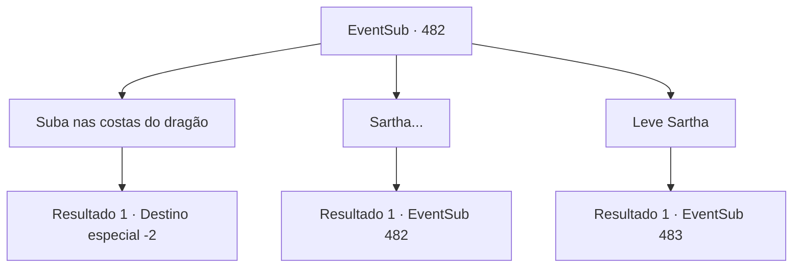

# Eventos secundários · 482

[Índice da tabela](index.md) · [Índice geral](../index.md)

ID: `pt:EventSub:482` · Fonte: `EventSub4` · Versão: 1.2.47.

Mapeamento estático dos arquivos; a disponibilidade e a execução dependem do estado da run.

## Texto do evento

*Sem texto no arquivo.*

## Dados de entrada

```json
{
  "id": 482,
  "grade": 1,
  "subEvent": "",
  "required": ""
}
```

## Mapa das escolhas



## Escolhas e resultados

### Escolha 1

Suba nas costas do dragão

Requisitos e outros campos da escolha:

```json
{
  "required": ""
}
```

#### Resultado 1.1

Você e Ternach saem da caverna. O sol está começando a se pôr atrás das montanhas a oeste, pintando o deserto de azul escuro. Assim que você sobe nas costas de Ternach, o dragão abre suas asas enormes e sobe ao céu. Muito em breve você chega em uma colina com vista para Antitikarr. Ternach fala, te deixando lá. 

 "Eu vou estar esperando aqui, então volte novamente."

 Você se despede de Ternach.

Continuação registrada: [Destino especial `-2`](../destinos-especiais.md).

```json
{
  "required": "",
  "chance": "1",
  "nextEvent": -2,
  "type": 2,
  "reward": "12_9_3"
}
```

### Escolha 2

Sartha...

Requisitos e outros campos da escolha:

```json
{
  "required": "5_453_0"
}
```

#### Resultado 2.1

Você menciona Sartha, que ainda está em cativeiro. Então Ternach olha para você e suspira. 

 "Agora, se vocês escolherem aquele anão novamente... Ficarei realmente desapontado..."


Continuação registrada: [Evento 482](0482.md) na mesma tabela.

```json
{
  "required": "",
  "chance": "1",
  "nextEvent": 482,
  "type": 2,
  "reward": "5_453_1"
}
```

### Escolha 3

Leve Sartha

Requisitos e outros campos da escolha:

```json
{
  "required": "5_453_1"
}
```

#### Resultado 3.1

Você tira Sartha da caverna do dragão. Sartha olha para você e agradece. 

 "Você tem um estômago forte. Aquela coisa feia... Mm-hmm. De qualquer forma, obrigado por me salvar, {1}. Eu não vou esquecer esse favor."

 Enquanto vocês voltam para Antitikarr, o sol começa a se pôr atrás das montanhas a oeste, pintando o deserto de azul escuro. Então Sartha fala. 

 "Acho que ainda temos um longo caminho pela frente, então que tal chamarmos isso de uma noite?"


Continuação registrada: [Evento 483](0483.md) na mesma tabela.

```json
{
  "required": "",
  "chance": "1",
  "nextEvent": 483,
  "type": 2,
  "reward": ""
}
```

## Referências que chegam a este evento

- [Evento 481 · escolha 1 · resultado 1](0481.md#escolha-1)
- [Evento 481 · escolha 1 · resultado 2](0481.md#escolha-1)
- [Evento 482 · escolha 2 · resultado 1](0482.md#escolha-2)
- [Evento 491 · escolha 1 · resultado 1](0491.md#escolha-1)
- [Evento 491 · escolha 1 · resultado 2](0491.md#escolha-1)
