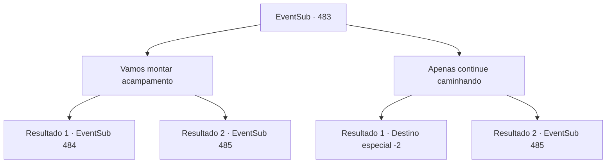

# Eventos secundários · 483

[Índice da tabela](index.md) · [Índice geral](../index.md)

ID: `pt:EventSub:483` · Fonte: `EventSub4` · Versão: 1.2.47.

Mapeamento estático dos arquivos; a disponibilidade e a execução dependem do estado da run.

## Texto do evento

*Sem texto no arquivo.*

## Dados de entrada

```json
{
  "id": 483,
  "grade": 1,
  "subEvent": "",
  "required": ""
}
```

## Mapa das escolhas



## Escolhas e resultados

### Escolha 1

Vamos montar acampamento

Requisitos e outros campos da escolha:

```json
{
  "required": ""
}
```

#### Resultado 1.1

Você decide montar uma barraca e dormir, como Sartha sugeriu.  O deserto à noite não se parece em nada com o deserto durante o dia.  A temperatura caiu abaixo de zero e ventos frios sopram pela areia.  Assim que você está dentro da barraca, Sartha senta ao seu lado e faz uma pergunta.  

 "O que você quer como recompensa? Em troca de me salvar."


Continuação registrada: [Evento 484](0484.md) na mesma tabela.

```json
{
  "required": "5_448_1|18_452_1",
  "chance": "1",
  "nextEvent": 484,
  "type": 2,
  "reward": ""
}
```

#### Resultado 1.2

Você decide montar uma barraca e dormir, como Sartha sugeriu.  O deserto à noite não se parece em nada com o deserto durante o dia.  A temperatura caiu abaixo de zero e ventos frios sopram pela areia.  Assim que você está dentro da barraca, Sartha se deita e imediatamente adormece, roncando. Você também se deita, tampando os ouvidos.

Continuação registrada: [Evento 485](0485.md) na mesma tabela.

```json
{
  "required": "-1|18_448_1|5_452_1",
  "chance": "1",
  "nextEvent": 485,
  "type": 2,
  "reward": ""
}
```

### Escolha 2

Apenas continue caminhando

Requisitos e outros campos da escolha:

```json
{
  "required": ""
}
```

#### Resultado 2.1

Você diz a Sartha que quer continuar caminhando. O deserto à noite não se parece em nada com o deserto durante o dia. A temperatura caiu abaixo de zero e ventos frios sopram pela areia. Mesmo assim, você continua caminhando. Sartha resmunga ao seu lado. 

 Depois de caminhar por muito tempo, você chega de volta a Antitikarr. O sol ainda não nasceu, então a vila ainda está quieta. 

 "Não consigo acreditar... Nunca caminhei tanto assim... Preciso encontrar um lugar para ficar."

 Sartha entra direto na estalagem mais próxima e pega um quarto. 

 "Você não precisa mais me ajudar. Os subordinados do meu pai virão me encontrar. Eu vou te convidar para Radania mais cedo ou mais tarde."

 Ela se despede de você e fecha a porta.

Continuação registrada: [Destino especial `-2`](../destinos-especiais.md).

```json
{
  "required": "",
  "chance": "1|0_13_1",
  "nextEvent": -2,
  "type": 0,
  "reward": "12_9_4"
}
```

#### Resultado 2.2

Você diz a Sartha que quer continuar caminhando. O deserto à noite não se parece em nada com o deserto durante o dia. A temperatura caiu abaixo de zero e ventos frios sopram pela areia. Incapaz de suportar, você eventualmente decide montar acampamento para a noite, como Sartha sugeriu. Assim que você está na tenda, Sartha se deita e imediatamente adormece, roncando. Você também se deita, tampando os ouvidos.

Continuação registrada: [Evento 485](0485.md) na mesma tabela.

```json
{
  "required": "",
  "chance": "15",
  "nextEvent": 485,
  "type": 1,
  "reward": ""
}
```

## Referências que chegam a este evento

- [Evento 480 · escolha 2 · resultado 1](0480.md#escolha-2)
- [Evento 481 · escolha 1 · resultado 3](0481.md#escolha-1)
- [Evento 481 · escolha 1 · resultado 4](0481.md#escolha-1)
- [Evento 481 · escolha 2 · resultado 1](0481.md#escolha-2)
- [Evento 482 · escolha 3 · resultado 1](0482.md#escolha-3)
- [Evento 488 · escolha 2 · resultado 1](0488.md#escolha-2)
- [Evento 489 · escolha 2 · resultado 1](0489.md#escolha-2)
- [Evento 491 · escolha 1 · resultado 3](0491.md#escolha-1)
- [Evento 491 · escolha 2 · resultado 1](0491.md#escolha-2)
