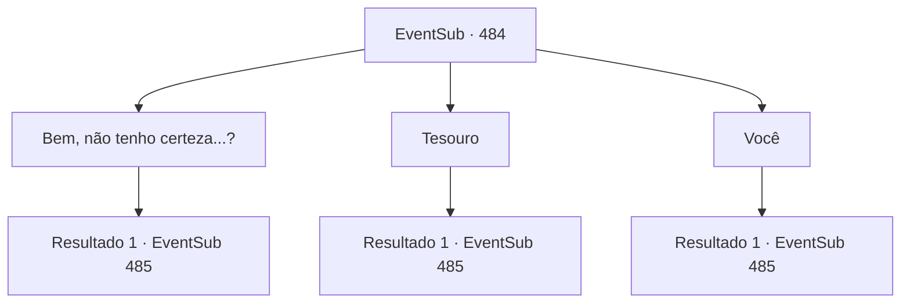

# Eventos secundários · 484

[Índice da tabela](index.md) · [Índice geral](../index.md)

ID: `pt:EventSub:484` · Fonte: `EventSub4` · Versão: 1.2.47.

Mapeamento estático dos arquivos; a disponibilidade e a execução dependem do estado da run.

## Texto do evento

*Sem texto no arquivo.*

## Dados de entrada

```json
{
  "id": 484,
  "grade": 1,
  "subEvent": "",
  "required": ""
}
```

## Mapa das escolhas



## Escolhas e resultados

### Escolha 1

Bem, não tenho certeza...?

Requisitos e outros campos da escolha:

```json
{
  "required": ""
}
```

#### Resultado 1.1

Sartha concorda com sua resposta e murmura algo para si mesma. 

 "Hoho... você é tímido."

 Então ela se deita suavemente e adormece, roncando. Você também se deita, tampando os ouvidos.

Continuação registrada: [Evento 485](0485.md) na mesma tabela.

```json
{
  "required": "",
  "chance": "1",
  "nextEvent": 485,
  "type": 2,
  "reward": ""
}
```

### Escolha 2

Tesouro

Requisitos e outros campos da escolha:

```json
{
  "required": ""
}
```

#### Resultado 2.1

Sartha concorda com sua resposta e murmura algo para si mesma. 

 "Hoho... você é tímido."

 Então ela se deita suavemente e adormece, roncando. Você também se deita, tampando os ouvidos.

Continuação registrada: [Evento 485](0485.md) na mesma tabela.

```json
{
  "required": "",
  "chance": "1",
  "nextEvent": 485,
  "type": 2,
  "reward": ""
}
```

### Escolha 3

Você

Requisitos e outros campos da escolha:

```json
{
  "required": "24_1_1"
}
```

#### Resultado 3.1

Sua resposta faz Sarta corar. 

 "Você é... honesto. Serei honesta com você também. Quando eu voltar, vou perguntar ao meu pai se posso me casar com você."

 Então ela se deita suavemente e adormece, roncando. Você também se deita, tampando os ouvidos.

Continuação registrada: [Evento 485](0485.md) na mesma tabela.

```json
{
  "required": "",
  "chance": "1",
  "nextEvent": 485,
  "type": 2,
  "reward": ""
}
```

## Referências que chegam a este evento

- [Evento 483 · escolha 1 · resultado 1](0483.md#escolha-1)
