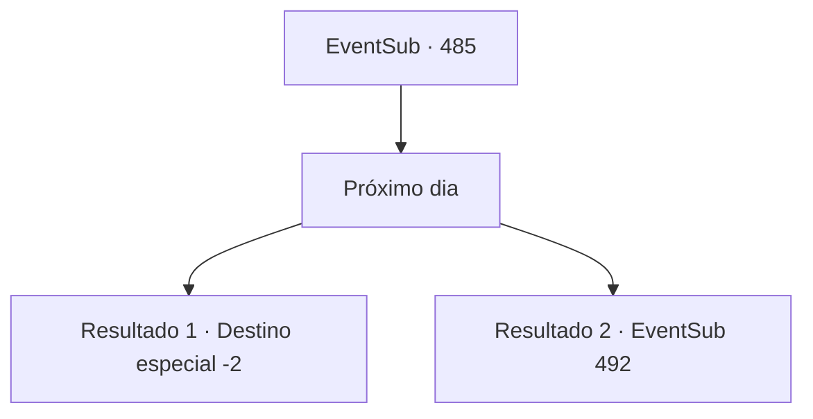

# Eventos secundários · 485

[Índice da tabela](index.md) · [Índice geral](../index.md)

ID: `pt:EventSub:485` · Fonte: `EventSub4` · Versão: 1.2.47.

Mapeamento estático dos arquivos; a disponibilidade e a execução dependem do estado da run.

## Texto do evento

*Sem texto no arquivo.*

## Dados de entrada

```json
{
  "id": 485,
  "grade": 1,
  "subEvent": "",
  "required": ""
}
```

## Mapa das escolhas



## Escolhas e resultados

### Escolha 1

Próximo dia

Requisitos e outros campos da escolha:

```json
{
  "required": ""
}
```

#### Resultado 1.1

O sol nasce, e você e Sartha seguem direto para Antitikarr. Não demora muito para vocês chegarem ao destino. Vocês encontram Mansa novamente na entrada da vila. Sartha pede a ele para levá-la a Radania. É muito longe para ir a pé, então ela quer alugar um camelo. 

 "Hmm... Entendi. Isso não é problema, desde que você pague por isso."

 Mansa diz que a caravana partirá em breve, e Sartha pode viajar com eles. Sartha se vira para você com um sorriso elegante. 

 "Obrigada pela sua gentileza. Ah, e entrarei em contato com você quando chegar a Radania, {1}."

 Sarta e Mansa se despedem de você.

Continuação registrada: [Destino especial `-2`](../destinos-especiais.md).

```json
{
  "required": "18_446_3",
  "chance": "1",
  "nextEvent": -2,
  "type": 2,
  "reward": "12_9_4"
}
```

#### Resultado 1.2

O sol nasce, e você e Sartha seguem direto para Antitikarr. Não demora muito para chegar ao seu destino. Você encontra Mansa novamente na entrada da vila. Sartha observa sua caravana e tudo ao redor, então abre a boca. 

 "Ótimo. Vamos pegar um camelo emprestado deles para chegar a Radania."

 Você lembra que esses comerciantes lhe deram iscas falsas.

Continuação registrada: [Evento 492](0492.md) na mesma tabela.

```json
{
  "required": "5_446_3",
  "chance": "1",
  "nextEvent": 492,
  "type": 2,
  "reward": ""
}
```

## Referências que chegam a este evento

- [Evento 483 · escolha 1 · resultado 2](0483.md#escolha-1)
- [Evento 483 · escolha 2 · resultado 2](0483.md#escolha-2)
- [Evento 484 · escolha 1 · resultado 1](0484.md#escolha-1)
- [Evento 484 · escolha 2 · resultado 1](0484.md#escolha-2)
- [Evento 484 · escolha 3 · resultado 1](0484.md#escolha-3)
