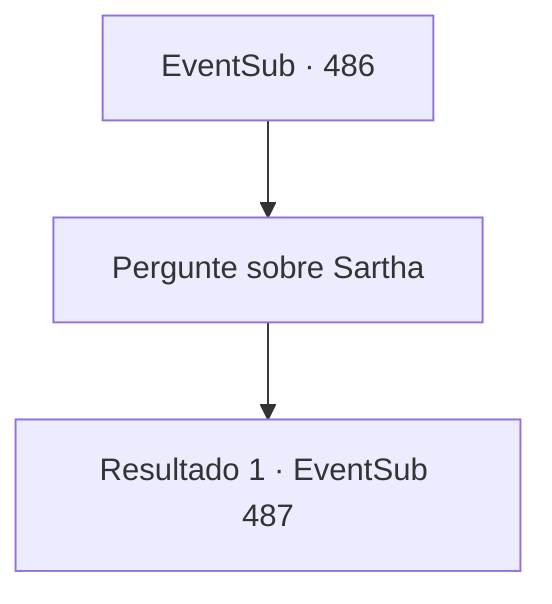

# Eventos secundários · 486

[Índice da tabela](index.md) · [Índice geral](../index.md)

ID: `pt:EventSub:486` · Fonte: `EventSub4` · Versão: 1.2.47.

Mapeamento estático dos arquivos; a disponibilidade e a execução dependem do estado da run.

## Texto do evento

*Sem texto no arquivo.*

## Dados de entrada

```json
{
  "id": 486,
  "grade": 1,
  "subEvent": "",
  "required": ""
}
```

## Mapa das escolhas



## Escolhas e resultados

### Escolha 1

Pergunte sobre Sartha

Requisitos e outros campos da escolha:

```json
{
  "required": ""
}
```

#### Resultado 1.1

Ternach responde com uma expressão de nojo. 

 "Como acontece que um bando de anões veio até mim, fazendo um alvoroço sobre dar-lhes Sartha... Siga-me."

 Você segue Ternach. 

 Logo depois, você chega a uma enorme duna. Ternach bate suas asas, e a areia é soprada, revelando uma caverna de pedra que estava enterrada sob a duna. 

 "Ela está aqui."


Continuação registrada: [Evento 487](0487.md) na mesma tabela.

```json
{
  "required": "",
  "chance": "1",
  "nextEvent": 487,
  "type": 2,
  "reward": ""
}
```

## Referências que chegam a este evento

- [Evento 470 · escolha 1 · resultado 1](0470.md#escolha-1)
- [Evento 470 · escolha 1 · resultado 2](0470.md#escolha-1)
