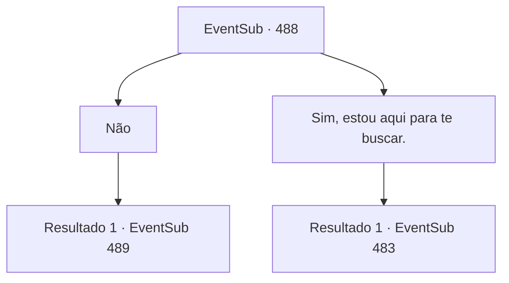

# Eventos secundários · 488

[Índice da tabela](index.md) · [Índice geral](../index.md)

ID: `pt:EventSub:488` · Fonte: `EventSub4` · Versão: 1.2.47.

Mapeamento estático dos arquivos; a disponibilidade e a execução dependem do estado da run.

## Texto do evento

*Sem texto no arquivo.*

## Dados de entrada

```json
{
  "id": 488,
  "grade": 1,
  "subEvent": "",
  "required": ""
}
```

## Mapa das escolhas



## Escolhas e resultados

### Escolha 1

Não

Requisitos e outros campos da escolha:

```json
{
  "required": ""
}
```

#### Resultado 1.1

Você diz a Sartha que não é o caso. Então Ternach questiona você, inclinando a cabeça. 

 "Hmm... Sério? Não é esse o anão que vocês estavam procurando?"

 Você balança a cabeça e repete que não está aqui por Sartha. O dragão assente. Sartha grita urgentemente. 

 "Sa, me salve! Meu pai irá recompensá-lo!"

 Ternach te adverte sem tentar esconder seu descontentamento. É melhor você não tentar levar Sarta.

Continuação registrada: [Evento 489](0489.md) na mesma tabela.

```json
{
  "required": "",
  "chance": "1",
  "nextEvent": 489,
  "type": 2,
  "reward": ""
}
```

### Escolha 2

Sim, estou aqui para te buscar.

Requisitos e outros campos da escolha:

```json
{
  "required": ""
}
```

#### Resultado 2.1

Você diz que vai levar Sartha de volta para casa. Ternach acena com a cabeça e responde. 

 "Então leve-a. É um pouco decepcionante, mas não pode ser evitado."

 Você e Sartha saem da toca do dragão. Sartha olha para você e agradece. 

 "Obrigado por me salvar, {1}. Não vou esquecer esse favor."

 Enquanto vocês voltam para Antitikarr, o sol começa a se pôr atrás das montanhas a oeste, pintando o deserto de azul escuro. Então Sartha fala. 

 "Acho que ainda temos um longo caminho pela frente, então que tal chamarmos isso de uma noite?"


Continuação registrada: [Evento 483](0483.md) na mesma tabela.

```json
{
  "required": "",
  "chance": "1",
  "nextEvent": 483,
  "type": 2,
  "reward": ""
}
```

## Referências que chegam a este evento

- [Evento 487 · escolha 1 · resultado 1](0487.md#escolha-1)
