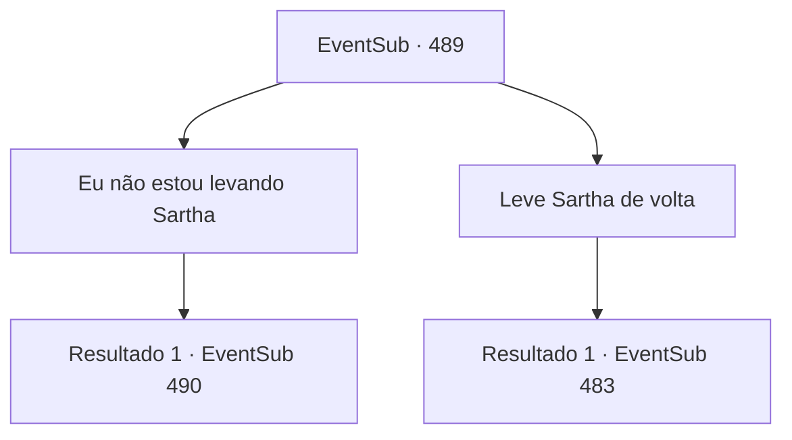

# Eventos secundários · 489

[Índice da tabela](index.md) · [Índice geral](../index.md)

ID: `pt:EventSub:489` · Fonte: `EventSub4` · Versão: 1.2.47.

Mapeamento estático dos arquivos; a disponibilidade e a execução dependem do estado da run.

## Texto do evento

*Sem texto no arquivo.*

## Dados de entrada

```json
{
  "id": 489,
  "grade": 1,
  "subEvent": "",
  "required": ""
}
```

## Mapa das escolhas



## Escolhas e resultados

### Escolha 1

Eu não estou levando Sartha

Requisitos e outros campos da escolha:

```json
{
  "required": ""
}
```

#### Resultado 1.1

Sartha te ouve e responde com uma expressão decepcionada. 

 "Você não veio me salvar...?"

 Ternach tem uma reação oposta e responde com um sorriso. 

 "Ah, que pena. Fique aí dentro."

 Ternach coloca Sartha de volta no poço. Então, Ternach se senta em um monte de tesouros de ouro e prata que parecem ser usados como cama. 

 "Mas... Por que vocês de repente mudaram de ideia?"

 O dragão pergunta por que você teria vindo até aqui por Sartha e então não a resgataria de fato.

Continuação registrada: [Evento 490](0490.md) na mesma tabela.

```json
{
  "required": "",
  "chance": "1",
  "nextEvent": 490,
  "type": 2,
  "reward": ""
}
```

### Escolha 2

Leve Sartha de volta

Requisitos e outros campos da escolha:

```json
{
  "required": ""
}
```

#### Resultado 2.1

Você diz que vai levar Sartha de volta para casa. Ternach acena com a cabeça e responde. 

 "Então leve-a. É um pouco decepcionante, mas não pode ser evitado."

 Você e Sartha saem da toca do dragão. Sartha olha para você e agradece. 

 "Obrigado por me salvar, {1}. Não vou esquecer esse favor."

 Enquanto vocês voltam para Antitikarr, o sol começa a se pôr atrás das montanhas a oeste, pintando o deserto de azul escuro. Então Sartha fala. 

 "Acho que ainda temos um longo caminho pela frente, então que tal chamarmos isso de uma noite?"


Continuação registrada: [Evento 483](0483.md) na mesma tabela.

```json
{
  "required": "",
  "chance": "1",
  "nextEvent": 483,
  "type": 2,
  "reward": "5_448_1"
}
```

## Referências que chegam a este evento

- [Evento 488 · escolha 1 · resultado 1](0488.md#escolha-1)
