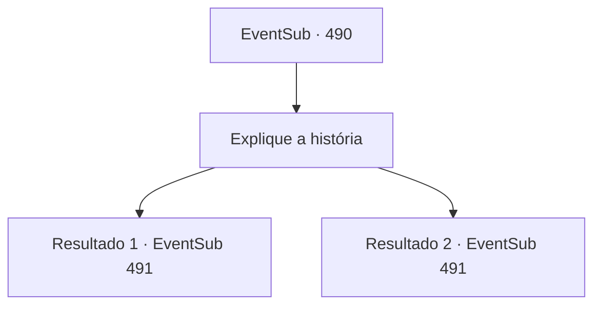

# Eventos secundários · 490

[Índice da tabela](index.md) · [Índice geral](../index.md)

ID: `pt:EventSub:490` · Fonte: `EventSub4` · Versão: 1.2.47.

Mapeamento estático dos arquivos; a disponibilidade e a execução dependem do estado da run.

## Texto do evento

*Sem texto no arquivo.*

## Dados de entrada

```json
{
  "id": 490,
  "grade": 1,
  "subEvent": "",
  "required": ""
}
```

## Mapa das escolhas



## Escolhas e resultados

### Escolha 1

Explique a história

Requisitos e outros campos da escolha:

```json
{
  "required": ""
}
```

#### Resultado 1.1

Você conta a Ternach a história de ter visto o quadro de empregos na cidade. O cliente disse que se alguém encontrar Sartha e a devolver, ele permitirá que eles se casem com Sartha como recompensa. Mas você diz que mudou de ideia assim que viu Sartha. 

 "Bem, ah-tá.."

 Ternach esfrega o queixo como se estivesse pensando em algo, e então tira sua roupa exterior. Com um tom sedutor, ela continua. 

 "Vocês querem ver como eu sou? Eu acho que sou melhor do que aquele anão."|drawing_ternachFemale|

Continuação registrada: [Evento 491](0491.md) na mesma tabela.

```json
{
  "required": "11_0_0",
  "chance": "1",
  "nextEvent": 491,
  "type": 2,
  "reward": ""
}
```

#### Resultado 1.2

Você conta a Ternach a história de ter visto o quadro de empregos na cidade. O cliente disse que se alguém encontrar Sartha e a devolver, ele permitirá que eles se casem com Sartha como recompensa. Mas você diz que mudou de ideia assim que viu Sartha. 

 "Bem, ah-tá.."

 Ternach esfrega o queixo como se estivesse pensando em algo, e então tira sua vestimenta externa. Com um tom sedutor, ele continua. 

 "Vocês querem ver como vocês gostam de mim? Eu acho que sou melhor do que aquele anão."|drawing_ternachMale|

Continuação registrada: [Evento 491](0491.md) na mesma tabela.

```json
{
  "required": "11_0_1",
  "chance": "1",
  "nextEvent": 491,
  "type": 2,
  "reward": ""
}
```

## Referências que chegam a este evento

- [Evento 489 · escolha 1 · resultado 1](0489.md#escolha-1)
