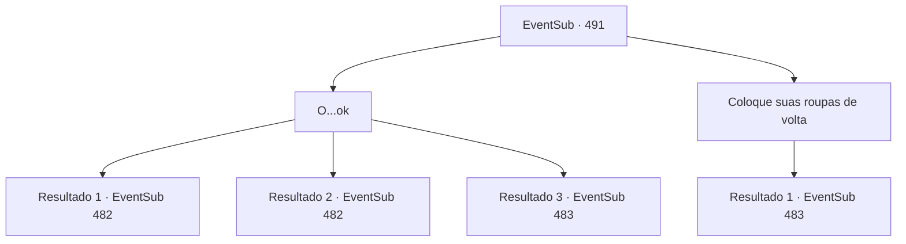

# Eventos secundários · 491

[Índice da tabela](index.md) · [Índice geral](../index.md)

ID: `pt:EventSub:491` · Fonte: `EventSub4` · Versão: 1.2.47.

Mapeamento estático dos arquivos; a disponibilidade e a execução dependem do estado da run.

## Texto do evento

*Sem texto no arquivo.*

## Dados de entrada

```json
{
  "id": 491,
  "grade": 1,
  "subEvent": "",
  "required": ""
}
```

## Mapa das escolhas



## Escolhas e resultados

### Escolha 1

O...ok

Requisitos e outros campos da escolha:

```json
{
  "required": ""
}
```

#### Resultado 1.1

Juntos, vocês têm uma 'conversa' áspera e primal com seus corpos. No final, todo o seu corpo está encharcado de suor. Ternach não está suando, mas parece estar ofegante. Quando ela exala, sua respiração é quente. 

 "Ufa..."

 Ela estende a mão e te ajuda a levantar. Ela diz que vai te levar de volta de onde você veio. Então, Ternach volta à sua forma original e te diz para subir em suas costas.

Continuação registrada: [Evento 482](0482.md) na mesma tabela.

```json
{
  "required": "11_0_0",
  "chance": "1|0_13_1",
  "nextEvent": 482,
  "type": 0,
  "reward": ""
}
```

#### Resultado 1.2

Juntos, vocês têm uma 'conversa' áspera e primal com seus corpos. No final, todo o seu corpo está encharcado de suor. Ternach não está suando, mas parece estar ofegante. Quando ele exala, sua respiração é quente. 

 "Ufa..."

 Ele estende a mão e ajuda você a levantar. Ele diz que vai te levar de volta de onde você veio. Então, Ternach volta à sua forma original e diz para você subir em suas costas.

Continuação registrada: [Evento 482](0482.md) na mesma tabela.

```json
{
  "required": "11_0_1",
  "chance": "1|0_13_1",
  "nextEvent": 482,
  "type": 0,
  "reward": ""
}
```

#### Resultado 1.3

Você cai no chão, de repente se sentindo muito tonto. Ternach suspira e olha para você. 

 "Ufa... Eu não acho que você combina comigo. Apenas leve o anão ali."

 Você acaba resgatando Sartha do covil do dragão. Sartha olha para você e agradece. 

 "Você tem um estômago forte. Aquela coisa feia... Mm-hmm. De qualquer forma, obrigado por me salvar, {1}. Eu não vou esquecer esse favor."

 Enquanto você volta para Antitikarr, o sol começa a se pôr atrás das montanhas a oeste, pintando o deserto de azul escuro. Então Sartha fala. 

 "Acho que ainda temos um longo caminho pela frente, então que tal chamarmos isso de uma noite?"


Continuação registrada: [Evento 483](0483.md) na mesma tabela.

```json
{
  "required": "",
  "chance": "16",
  "nextEvent": 483,
  "type": 1,
  "reward": "5_452_1"
}
```

### Escolha 2

Coloque suas roupas de volta

Requisitos e outros campos da escolha:

```json
{
  "required": ""
}
```

#### Resultado 2.1

A seu pedido, Ternach pega as roupas do chão. 

 "...Ok."

 Ternach está envergonhado e suspira. 

 "Então leve-a. É um pouco decepcionante, mas não posso fazer nada."

 Você e Sartha saem da caverna do dragão. Sartha olha para você e agradece. 

 "Obrigado por me salvar, {1}. Não vou esquecer esse favor."

 Enquanto vocês voltam para Antitikarr, o sol começa a se pôr atrás das montanhas a oeste, pintando o deserto de azul escuro. Então Sartha fala. 

 "Acho que ainda temos um longo caminho pela frente, então que tal chamarmos isso de uma noite?"


Continuação registrada: [Evento 483](0483.md) na mesma tabela.

```json
{
  "required": "",
  "chance": "1",
  "nextEvent": 483,
  "type": 2,
  "reward": ""
}
```

## Referências que chegam a este evento

- [Evento 490 · escolha 1 · resultado 1](0490.md#escolha-1)
- [Evento 490 · escolha 1 · resultado 2](0490.md#escolha-1)
