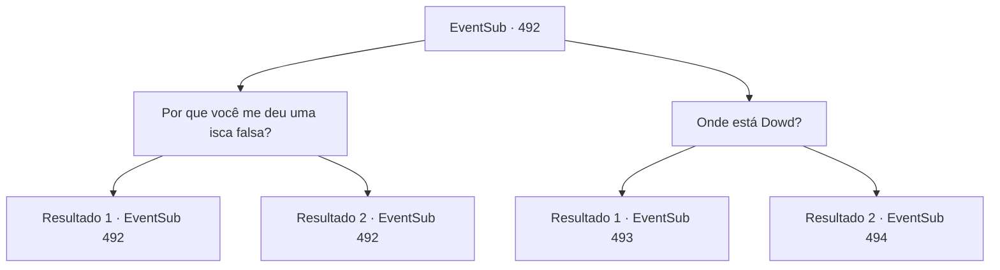

# Eventos secundários · 492

[Índice da tabela](index.md) · [Índice geral](../index.md)

ID: `pt:EventSub:492` · Fonte: `EventSub4` · Versão: 1.2.47.

Mapeamento estático dos arquivos; a disponibilidade e a execução dependem do estado da run.

## Texto do evento

*Sem texto no arquivo.*

## Dados de entrada

```json
{
  "id": 492,
  "grade": 1,
  "subEvent": "",
  "required": ""
}
```

## Mapa das escolhas



## Escolhas e resultados

### Escolha 1

Por que você me deu uma isca falsa?

Requisitos e outros campos da escolha:

```json
{
  "required": "5_454_0"
}
```

#### Resultado 1.1

Você se aproxima de Mansa e pergunta por que ele lhe deu isca falsa de dragão e enviou assassinos atrás de você. Ele finge não ter ideia do que você está falando. 

 "Do que... você está falando?"

 Ao seu lado, Sartha o observa atentamente.

Continuação registrada: [Evento 492](0492.md) na mesma tabela.

```json
{
  "required": "10_93_1",
  "chance": "1",
  "nextEvent": 492,
  "type": 2,
  "reward": "5_454_1"
}
```

#### Resultado 1.2

Você se aproxima de Mansa e empurra o 'Respondedor' em seu pescoço. Você pergunta por que ele lhe deu uma isca falsa de dragão e enviou assassinos atrás de você. 

 "Você... Você nos provocou primeiro."

 Ele rapidamente cobre a boca, seus olhos se arregalando.

Continuação registrada: [Evento 492](0492.md) na mesma tabela.

```json
{
  "required": "8_93_1",
  "chance": "1",
  "nextEvent": 492,
  "type": 2,
  "reward": "5_454_2"
}
```

### Escolha 2

Onde está Dowd?

Requisitos e outros campos da escolha:

```json
{
  "required": "18_454_0"
}
```

#### Resultado 2.1

Mansa responde com um encolher de ombros. 

 "Qual Dowd você está falando..? É um nome bastante popular. Haha."

 Assim que Mansa menciona o nome 'Dowd', vários comerciantes e seus guardas começam a se aproximar dele. Sartha abre a boca. 

 "A coisa importante a ter em mente é... Eu preciso dos camelos deles. É um longo caminho até Radania, então eu não conseguirei chegar lá a menos que eu possa alugar os camelos deles. Tente não causar confusão."


Continuação registrada: [Evento 493](0493.md) na mesma tabela.

```json
{
  "required": "5_454_1",
  "chance": "1",
  "nextEvent": 493,
  "type": 2,
  "reward": ""
}
```

#### Resultado 2.2

Mansa dá um passo para trás e grita. 

 "Todos! Livrem-se deles!"

 Assassinos aparecem de repente, em cima dos telhados e espiando pelas vielas. Então, Sartha grita. 

 "Espera! Vamos conversar sobre isso! Meu nome é Sartha, filha do Senhor Radania. Se vocês nos atacarem, os soldados de Radania nunca irão perdoá-los!"

 Mansa resmunga e responde. 

 "Hein! Que besteira você está falando? Você teria que ser muito mais bonita se quisesse se passar por aquela famosa beleza!"

 Assim que ele termina de falar, os assassinos atacam você.

Continuação registrada: [Evento 494](0494.md) na mesma tabela.

```json
{
  "required": "5_454_2",
  "chance": "1",
  "nextEvent": 494,
  "type": 2,
  "reward": "6_3_48",
  "place": 4
}
```

## Referências que chegam a este evento

- [Evento 485 · escolha 1 · resultado 2](0485.md#escolha-1)
- [Evento 492 · escolha 1 · resultado 1](0492.md#escolha-1)
- [Evento 492 · escolha 1 · resultado 2](0492.md#escolha-1)
