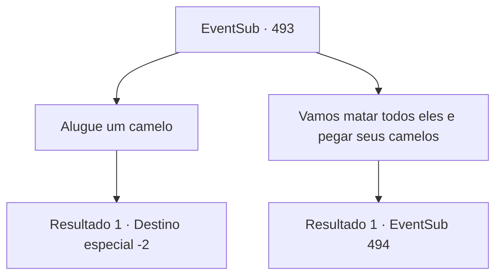

# Eventos secundários · 493

[Índice da tabela](index.md) · [Índice geral](../index.md)

ID: `pt:EventSub:493` · Fonte: `EventSub4` · Versão: 1.2.47.

Mapeamento estático dos arquivos; a disponibilidade e a execução dependem do estado da run.

## Texto do evento

*Sem texto no arquivo.*

## Dados de entrada

```json
{
  "id": 493,
  "grade": 1,
  "subEvent": "",
  "required": ""
}
```

## Mapa das escolhas



## Escolhas e resultados

### Escolha 1

Alugue um camelo

Requisitos e outros campos da escolha:

```json
{
  "required": ""
}
```

#### Resultado 1.1

Você decide ouvir Sartha. Quando você pergunta a Mansa sobre alugar um camelo, ele acena gentilmente. 

 "Por que você quer emprestar um camelo?"

 Sartha se aproxima e o cumprimenta com um gesto elegante. 

 "Eu sou a amada dama de Radania, 'Radan Sartha'. Acabei de ser resgatada de um dragão feroz. Eu quero sua ajuda para voltar para Radania."

 Os comerciantes conversam entre si e logo decidem emprestar um camelo para ela. Sartha sobe no camelo e acena para você. 

 "Eu posso cuidar das coisas daqui. Obrigada por me salvar. Em breve, vou te convidar para Radania!"


Continuação registrada: [Destino especial `-2`](../destinos-especiais.md).

```json
{
  "required": "",
  "chance": "1",
  "nextEvent": -2,
  "type": 2,
  "reward": "12_9_6"
}
```

### Escolha 2

Vamos matar todos eles e pegar seus camelos

Requisitos e outros campos da escolha:

```json
{
  "required": ""
}
```

#### Resultado 2.1

Sartha fica surpreso com sua sugestão absurda. Mansa dá um passo para trás e grita. 

 "Todos! Livrem-se deles!"

 Assassinos aparecem de repente, em cima dos telhados e espiando pelas vielas.

Continuação registrada: [Evento 494](0494.md) na mesma tabela.

```json
{
  "required": "",
  "chance": "1",
  "nextEvent": 494,
  "type": 2,
  "reward": "6_3_48",
  "place": 4
}
```

## Referências que chegam a este evento

- [Evento 492 · escolha 2 · resultado 1](0492.md#escolha-2)
