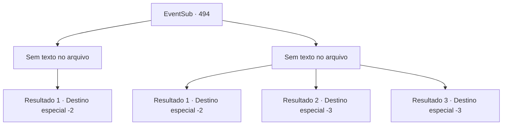

# Eventos secundários · 494

[Índice da tabela](index.md) · [Índice geral](../index.md)

ID: `pt:EventSub:494` · Fonte: `EventSub4` · Versão: 1.2.47.

Mapeamento estático dos arquivos; a disponibilidade e a execução dependem do estado da run.

## Texto do evento

*Sem texto no arquivo.*

## Dados de entrada

```json
{
  "id": 494,
  "grade": 1,
  "subEvent": "",
  "required": ""
}
```

## Mapa das escolhas



## Escolhas e resultados

### Escolha 1

*Sem texto no arquivo; o papel dessa opção depende da interface do jogo.*

Requisitos e outros campos da escolha:

```json
{
  "required": ""
}
```

#### Resultado 1.1

Você se livra de todos os assassinos e enterra seus corpos na areia. 

 "Eu apenas encontrarei outra caravana para Radania. Obrigado por me salvar. Em breve, vou te convidar para Radania."

 Você se despede de Sartha e seguem caminhos diferentes.

Continuação registrada: [Destino especial `-2`](../destinos-especiais.md).

```json
{
  "required": "",
  "chance": "1",
  "nextEvent": -2,
  "type": 2,
  "reward": "12_9_4|0_3_-5"
}
```

### Escolha 2

*Sem texto no arquivo; o papel dessa opção depende da interface do jogo.*

Requisitos e outros campos da escolha:

```json
{
  "required": ""
}
```

#### Resultado 2.1

Você se encolhe no chão depois que eles te atacam. Eles te deixam deitado na areia e levam Sartha embora. Depois que eles vão embora, você vê que alguém deixou cair uma pulseira. Provavelmente pertence a Sartha. Você a pega.

Continuação registrada: [Destino especial `-2`](../destinos-especiais.md).

```json
{
  "required": "1_0_2|1_1_2",
  "chance": "1",
  "nextEvent": -2,
  "type": 2,
  "reward": "12_9_6|0_0_-1|0_1_-1|3_255_1"
}
```

#### Resultado 2.2

Você é esfaqueado pela espada de um assassino e cai de joelhos. A espada está revestida de veneno, que se espalha pelo seu corpo e te paralisa. 

 "Hmm... Você deveria ter esticado as pernas para cair em uma posição mais confortável."

 Mansa se aproxima com um sorriso. Ele tira sua espada e acerta seu pescoço.

Continuação registrada: [Destino especial `-3`](../destinos-especiais.md).

```json
{
  "required": "2_0_2",
  "chance": "1",
  "nextEvent": -3,
  "type": 2,
  "reward": "0_0_-1|0_1_-1"
}
```

#### Resultado 2.3

Você é esfaqueado pela espada de um assassino e cai de joelhos. A espada está revestida de veneno, que se espalha pelo seu corpo e te paralisa. 

 "Hmm... Você deveria ter esticado as pernas para cair em uma posição mais confortável."

 Mansa se aproxima com um sorriso. Ele tira sua espada e acerta seu pescoço.

Continuação registrada: [Destino especial `-3`](../destinos-especiais.md).

```json
{
  "required": "2_1_2",
  "chance": "1",
  "nextEvent": -3,
  "type": 2,
  "reward": "0_0_-1|0_1_-1"
}
```

## Referências que chegam a este evento

- [Evento 492 · escolha 2 · resultado 2](0492.md#escolha-2)
- [Evento 493 · escolha 2 · resultado 1](0493.md#escolha-2)
