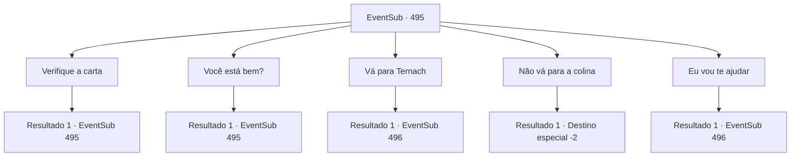

# Eventos secundários · 495

[Índice da tabela](index.md) · [Índice geral](../index.md)

ID: `pt:EventSub:495` · Fonte: `EventSub4` · Versão: 1.2.47.

Mapeamento estático dos arquivos; a disponibilidade e a execução dependem do estado da run.

## Texto do evento

Um anão de meia-idade com uma barba avermelhada se aproxima de você. Ele te entrega um pedaço de pergaminho. 

 "Ufa... Você é {1}, certo? Um dragão me pediu para entregar isso a você."

 Ele suspira enquanto você pega a carta.

## Dados de entrada

```json
{
  "id": 495,
  "grade": 1,
  "subEvent": "",
  "required": "12_9_3|1_2_40"
}
```

## Mapa das escolhas



## Escolhas e resultados

### Escolha 1

Verifique a carta

Requisitos e outros campos da escolha:

```json
{
  "required": "5_455_0"
}
```

#### Resultado 1.1

A carta está escrita em letras tortas, pedindo para você ir até a colina onde você se separou de Ternach. Após ler a carta, você a devolve ao anão. Ele olha para você como se quisesse dizer algo.

Continuação registrada: [Evento 495](0495.md) na mesma tabela.

```json
{
  "required": "",
  "chance": "1",
  "nextEvent": 495,
  "type": 2,
  "reward": "5_455_1"
}
```

### Escolha 2

Você está bem?

Requisitos e outros campos da escolha:

```json
{
  "required": "5_456_0|5_455_1"
}
```

#### Resultado 2.1

Assim que você pergunta, o anão responde imediatamente. 

 "Eu sou um mensageiro de Radania, 'Pé-Ligeiro Farnan'. Não tenho conseguido dormir há dias porque me sinto tão culpado por não conseguir salvar a mulher mais bonita do mundo. E não sou só eu que estou sofrendo. São todos os Radanianos."


Continuação registrada: [Evento 495](0495.md) na mesma tabela.

```json
{
  "required": "",
  "chance": "1",
  "nextEvent": 495,
  "type": 2,
  "reward": "5_456_1"
}
```

### Escolha 3

Vá para Ternach

Requisitos e outros campos da escolha:

```json
{
  "required": "5_455_1"
}
```

#### Resultado 3.1

Após alguns dias de viagem, você chega à colina onde Ternach está esperando. Lá você vê o dragão, empoleirado nas dunas de areia com vista para Antitikarr. Ternach parece ter sido enterrado na areia, mas ressurgiu com a sua chegada. 

 "Vocês todos estão aqui agora. Temos algum lugar para ir juntos."


Continuação registrada: [Evento 496](0496.md) na mesma tabela.

```json
{
  "required": "",
  "chance": "1",
  "nextEvent": 496,
  "type": 2,
  "reward": ""
}
```

### Escolha 4

Não vá para a colina

Requisitos e outros campos da escolha:

```json
{
  "required": "5_455_1"
}
```

#### Resultado 4.1

Você joga fora a carta de Ternach. E continua sua jornada, deixando para trás um anão muito confuso.

Continuação registrada: [Destino especial `-2`](../destinos-especiais.md).

```json
{
  "required": "",
  "chance": "1",
  "nextEvent": -2,
  "type": 2,
  "reward": "12_9_-1"
}
```

### Escolha 5

Eu vou te ajudar

Requisitos e outros campos da escolha:

```json
{
  "required": "5_456_1"
}
```

#### Resultado 5.1

Farnan parece emocionado com sua promessa. 

 "...que ato de coragem! Eu apreciaria se você fizesse isso!"

 Farnan diz que irá recompensá-lo se você a salvar. Você se despede dele e segue em direção à colina do deserto onde Ternach espera. 

 Após alguns dias de viagem, você chega à colina onde Ternach está esperando. Lá você vê o dragão, empoleirado nas dunas de areia com vista para Antitikarr. Ternach parece ter sido enterrado na areia, mas ressurgiu com sua chegada. 

 "Vocês todos estão aqui agora. Temos algum lugar para ir juntos."


Continuação registrada: [Evento 496](0496.md) na mesma tabela.

```json
{
  "required": "",
  "chance": "1",
  "nextEvent": 496,
  "type": 2,
  "reward": "5_456_2"
}
```

## Referências que chegam a este evento

- [Evento 495 · escolha 1 · resultado 1](0495.md#escolha-1)
- [Evento 495 · escolha 2 · resultado 1](0495.md#escolha-2)
