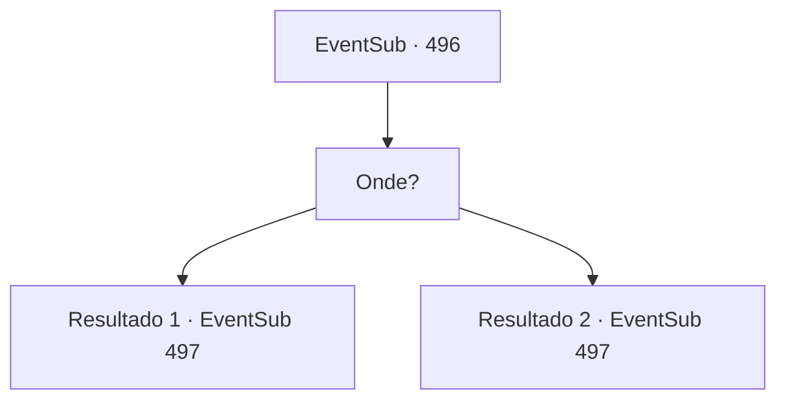

# Eventos secundários · 496

[Índice da tabela](index.md) · [Índice geral](../index.md)

ID: `pt:EventSub:496` · Fonte: `EventSub4` · Versão: 1.2.47.

Mapeamento estático dos arquivos; a disponibilidade e a execução dependem do estado da run.

## Texto do evento

*Sem texto no arquivo.*

## Dados de entrada

```json
{
  "id": 496,
  "grade": 1,
  "subEvent": "",
  "required": ""
}
```

## Mapa das escolhas



## Escolhas e resultados

### Escolha 1

Onde?

Requisitos e outros campos da escolha:

```json
{
  "required": ""
}
```

#### Resultado 1.1


 "Ah tenho que falar com meu pai."

 Ternach decola com você em suas costas. Você e o Dragão Azul voam pelo céu sem nuvens e chegam à costa ao norte do Grande Deserto. Você vê ondas agitadas batendo contra um penhasco feito de pedra preta. No meio do penhasco há uma grande entrada de caverna. Você e Ternach entram na caverna. 

 Quartzo, safiras e ametistas brilham enquanto bolas brancas de eletricidade pura iluminam o interior da vasta caverna. E no meio da caverna há um dragão azul pelo menos duas vezes maior que Ternach. O dragão gigante olha para você e Ternach, com um cachimbo na boca. Então o dragão fala. 

 "@#$%%^@#"

 Mas você não entende essas palavras. Ternach e o dragão gigante começam a conversar. Você não entende nada. Depois de terminarem de falar um com o outro, Ternach se vira para olhar para você.

Continuação registrada: [Evento 497](0497.md) na mesma tabela.

```json
{
  "required": "2_7_14",
  "chance": "1",
  "nextEvent": 497,
  "type": 2,
  "reward": ""
}
```

#### Resultado 1.2


 "Ah tenho que falar com meu pai."

 Ternach decola com você em suas costas. Você e o Dragão Azul voam pelo céu sem nuvens e chegam à costa ao norte do Grande Deserto. Você vê ondas agitadas batendo contra um penhasco feito de pedra preta. No meio do penhasco há uma grande entrada de caverna. Você e Ternach entram na caverna. 

 Quartzo, safiras e ametistas brilham enquanto bolas brancas de eletricidade pura iluminam o interior da vasta caverna. E no meio da caverna há um dragão azul pelo menos duas vezes maior que Ternach. O dragão gigante olha para você e Ternach, com um cachimbo na boca. Então o dragão fala. 

 "Ternarch. Você está aqui. O que está acontecendo?"

 Sua voz soa cheia de sabedoria. Ternach se curva educadamente e responde. 

 "Estou aqui para obter sua permissão para estar com este humano, Pai."

 Os olhos do pai de Ternach se abrem e ele suspira. 

 "Hmm... É mesmo? Bem, vou ter que garantir que você seja adequado para o meu filho."


Continuação registrada: [Evento 497](0497.md) na mesma tabela.

```json
{
  "required": "1_7_14",
  "chance": "1",
  "nextEvent": 497,
  "type": 2,
  "reward": "5_457_1"
}
```

## Referências que chegam a este evento

- [Evento 495 · escolha 3 · resultado 1](0495.md#escolha-3)
- [Evento 495 · escolha 5 · resultado 1](0495.md#escolha-5)
