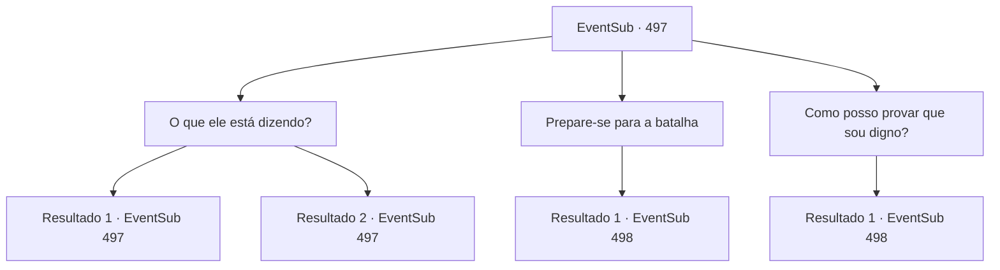

# Eventos secundários · 497

[Índice da tabela](index.md) · [Índice geral](../index.md)

ID: `pt:EventSub:497` · Fonte: `EventSub4` · Versão: 1.2.47.

Mapeamento estático dos arquivos; a disponibilidade e a execução dependem do estado da run.

## Texto do evento

*Sem texto no arquivo.*

## Dados de entrada

```json
{
  "id": 497,
  "grade": 1,
  "subEvent": "",
  "required": ""
}
```

## Mapa das escolhas



## Escolhas e resultados

### Escolha 1

O que ele está dizendo?

Requisitos e outros campos da escolha:

```json
{
  "required": "5_457_0"
}
```

#### Resultado 1.1

Ternach responde à sua pergunta. 

 "Papai vai ver se você é adequado para mim."

 Você percebe que o gigante dragão azul é o pai de Ternach.

Continuação registrada: [Evento 497](0497.md) na mesma tabela.

```json
{
  "required": "11_0_0",
  "chance": "1",
  "nextEvent": 497,
  "type": 2,
  "reward": "5_457_1"
}
```

#### Resultado 1.2

Ternach responde à sua pergunta. 

 "Papai vai ver se você é adequado para mim."

 Você percebe que o gigante dragão azul é o pai de Ternach.

Continuação registrada: [Evento 497](0497.md) na mesma tabela.

```json
{
  "required": "11_0_1",
  "chance": "1",
  "nextEvent": 497,
  "type": 2,
  "reward": "5_457_1"
}
```

### Escolha 2

Prepare-se para a batalha

Requisitos e outros campos da escolha:

```json
{
  "required": "5_457_1"
}
```

#### Resultado 2.1

Enquanto você se prepara para lutar contra o dragão, o gigante dragão começa a rir. 

 "Khahaha! Meu nome é Amunak, o pai de Ternach. Você tem muita coragem, mas eu tenho um teste para você. Faça-o."

 Ele entrega uma caixa grande. A caixa está lacrada com um cubo mágico em vez de uma fechadura. O cubo é composto por nove quadrados menores em cada lado, dispostos em três fileiras e três colunas. Cada quadrado é pintado com seis cores diferentes. 

 "Abra a caixa e faça um nó com o que está dentro."

 Você pega a caixa e sai da caverna com Ternach. Ternach fala com um tom interrogativo. 

 "Normalmente, um parceiro tem que provar sua força. Isso é inesperado. Vamos para casa e dar uma olhada."

 Você chega ao covil de Ternach. Você já esteve aqui antes. Ternach coloca a caixa no chão e se transforma em humano. Então aponta para o cubo que tranca a caixa e diz. 

 "Vocês resolvam isso. Vou alimentar o anão. Volto em um segundo."

 Ternach começa a puxar Sartha para fora do poço.

Continuação registrada: [Evento 498](0498.md) na mesma tabela.

```json
{
  "required": "",
  "chance": "1",
  "nextEvent": 498,
  "type": 2,
  "reward": ""
}
```

### Escolha 3

Como posso provar que sou digno?

Requisitos e outros campos da escolha:

```json
{
  "required": "5_457_1"
}
```

#### Resultado 3.1


 "Deixe-me me apresentar primeiro. Meu nome é Amunak. Eu sou o pai de Ternach. Este é o meu teste. Pegue-o."

 Ele entrega uma caixa grande. A caixa está lacrada com um cubo mágico em vez de uma fechadura. O cubo é composto por nove quadrados menores em cada lado, dispostos em três fileiras e três colunas. Cada quadrado é pintado com seis cores diferentes. 

 "Abra a caixa e faça um nó com o que está dentro."

 Você pega a caixa e sai da caverna com Ternach. Ternach fala com um tom interrogativo. 

 "Geralmente um parceiro tem que provar sua força. Isso é inesperado. Vamos para casa e dar uma olhada."

 Você chega ao covil de Ternach. Você já esteve aqui antes. Ternach coloca a caixa no chão e se transforma em humano. Então aponta para o cubo que tranca a caixa e diz. 

 "Vocês resolvam isso. Vou alimentar o anão. Volto em um segundo."

 Ternach começa a puxar Sartha para fora do poço.

Continuação registrada: [Evento 498](0498.md) na mesma tabela.

```json
{
  "required": "",
  "chance": "1",
  "nextEvent": 498,
  "type": 2,
  "reward": ""
}
```

## Referências que chegam a este evento

- [Evento 496 · escolha 1 · resultado 1](0496.md#escolha-1)
- [Evento 496 · escolha 1 · resultado 2](0496.md#escolha-1)
- [Evento 497 · escolha 1 · resultado 1](0497.md#escolha-1)
- [Evento 497 · escolha 1 · resultado 2](0497.md#escolha-1)
