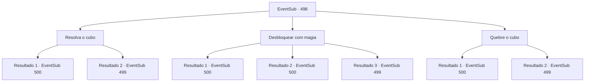

# Eventos secundários · 498

[Índice da tabela](index.md) · [Índice geral](../index.md)

ID: `pt:EventSub:498` · Fonte: `EventSub4` · Versão: 1.2.47.

Mapeamento estático dos arquivos; a disponibilidade e a execução dependem do estado da run.

## Texto do evento

*Sem texto no arquivo.*

## Dados de entrada

```json
{
  "id": 498,
  "grade": 1,
  "subEvent": "",
  "required": ""
}
```

## Mapa das escolhas



## Escolhas e resultados

### Escolha 1

Resolva o cubo

Requisitos e outros campos da escolha:

```json
{
  "required": ""
}
```

#### Resultado 1.1

Você gira o cubo ao redor e descobre como ele está estruturado. Quando você o gira e alinha de forma que cada lado do cubo tenha a mesma cor, o cubo desaparece e a caixa se abre. A caixa contém cinzas. Ternach retorna depois de dar comida para Sartha. Os olhos de Ternach se abrem quando você abre a caixa. 

 "O quê...? Como vocês conseguem amarrar um nó com cinzas?"


Continuação registrada: [Evento 500](0500.md) na mesma tabela.

```json
{
  "required": "",
  "chance": "1|0_14_1",
  "nextEvent": 500,
  "type": 0,
  "reward": ""
}
```

#### Resultado 1.2

Você gira o cubo, mas não sabe como resolvê-lo. Enquanto você está olhando para ele, você ouve a voz de Sartha. 

 "Eu, eu posso resolver isso. Esse cubo."

 Ela diz que se resolver o cubo, você deve libertá-la.

Continuação registrada: [Evento 499](0499.md) na mesma tabela.

```json
{
  "required": "",
  "chance": "20",
  "nextEvent": 499,
  "type": 1,
  "reward": ""
}
```

### Escolha 2

Desbloquear com magia

Requisitos e outros campos da escolha:

```json
{
  "required": "20_0_1"
}
```

#### Resultado 2.1

Você descobre como dissipar a magia do cubo e destruí-lo. À medida que o cubo desaparece, a caixa se abre. Dentro, há cinzas. Ternach retorna depois de dar comida a Sartha. Os olhos de Ternach se arregalam quando você abre a caixa. 

 "O quê...? Como vocês conseguem amarrar um nó com cinzas?"


Continuação registrada: [Evento 500](0500.md) na mesma tabela.

```json
{
  "required": "",
  "chance": "1|0_7_1",
  "nextEvent": 500,
  "type": 0,
  "reward": ""
}
```

#### Resultado 2.2

Você descobre como dissipar a magia do cubo e destruí-lo. À medida que o cubo desaparece, a caixa se abre. Dentro, há cinzas. Ternach retorna depois de dar comida a Sartha. Os olhos de Ternach se arregalam quando você abre a caixa. 

 "O quê...? Como vocês conseguem amarrar um nó com cinzas?"


Continuação registrada: [Evento 500](0500.md) na mesma tabela.

```json
{
  "required": "20_0_3",
  "chance": "1|0_7_1",
  "nextEvent": 500,
  "type": 0,
  "reward": ""
}
```

#### Resultado 2.3

Você não pode dissipar a magia do cubo e você não tem ideia de como resolvê-lo. Enquanto você está olhando para ele, você ouve a voz de Sartha. 

 "Eu, eu posso resolver isso. Esse cubo."

 Ela diz que se resolver o cubo, você deve libertá-la.

Continuação registrada: [Evento 499](0499.md) na mesma tabela.

```json
{
  "required": "",
  "chance": "22",
  "nextEvent": 499,
  "type": 1,
  "reward": ""
}
```

### Escolha 3

Quebre o cubo

Requisitos e outros campos da escolha:

```json
{
  "required": ""
}
```

#### Resultado 3.1

Dizem que se você tem uma mente forte, então você tem um corpo forte. Você acha que ouviu isso em algum lugar. Em vez de tentar resolver o cubo com a mente e ficar com dor de cabeça, você simplesmente o quebra. O cubo desaparece e a caixa se abre. A caixa contém cinzas. Ternach retorna depois de dar comida a Sartha. Os olhos de Ternach se abrem quando você abre a caixa. 

 "O quê...? Como vocês conseguem amarrar um nó com cinzas?"


Continuação registrada: [Evento 500](0500.md) na mesma tabela.

```json
{
  "required": "",
  "chance": "1|0_5_1",
  "nextEvent": 500,
  "type": 0,
  "reward": ""
}
```

#### Resultado 3.2

Você está tentando quebrar o cubo, mas nada está funcionando. Não importa o quanto você o bata - ou até mesmo pise nele - você nem consegue arranhar o cubo encantado. Enquanto você está olhando para ele, você ouve a voz de Sartha. 

 "Eu, eu posso resolvê-lo. Esse cubo."

 Ela diz que se resolver o cubo, você deve libertá-la.

Continuação registrada: [Evento 499](0499.md) na mesma tabela.

```json
{
  "required": "",
  "chance": "30",
  "nextEvent": 499,
  "type": 1,
  "reward": ""
}
```

## Referências que chegam a este evento

- [Evento 497 · escolha 2 · resultado 1](0497.md#escolha-2)
- [Evento 497 · escolha 3 · resultado 1](0497.md#escolha-3)
