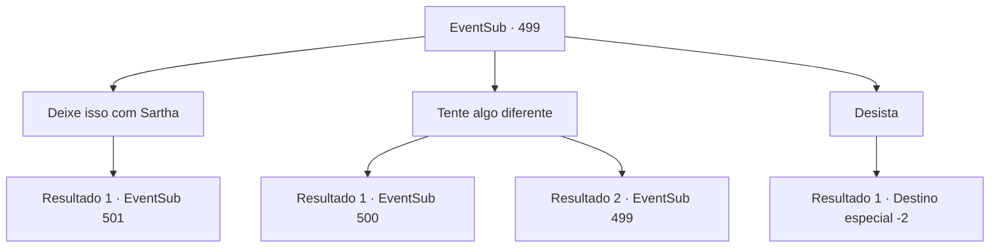

# Eventos secundários · 499

[Índice da tabela](index.md) · [Índice geral](../index.md)

ID: `pt:EventSub:499` · Fonte: `EventSub4` · Versão: 1.2.47.

Mapeamento estático dos arquivos; a disponibilidade e a execução dependem do estado da run.

## Texto do evento

*Sem texto no arquivo.*

## Dados de entrada

```json
{
  "id": 499,
  "grade": 1,
  "subEvent": "",
  "required": ""
}
```

## Mapa das escolhas



## Escolhas e resultados

### Escolha 1

Deixe isso com Sartha

Requisitos e outros campos da escolha:

```json
{
  "required": ""
}
```

#### Resultado 1.1

Sartha gira o cubo e logo o resolve com seus movimentos habilidosos das mãos. Conforme ela alinha cada lado do cubo com a mesma cor, o cubo desaparece e a caixa se abre. A caixa contém cinzas. Então Ternach se aproxima, olhos arregalados. 

 "O quê...? Como vocês conseguem amarrar um nó com cinzas?"

 Sartha responde. 

 "Eu também sei fazer isso. Mas... você tem que prometer me deixar ir antes de eu resolver o problema."


Continuação registrada: [Evento 501](0501.md) na mesma tabela.

```json
{
  "required": "",
  "chance": "1",
  "nextEvent": 501,
  "type": 2,
  "reward": ""
}
```

### Escolha 2

Tente algo diferente

Requisitos e outros campos da escolha:

```json
{
  "required": "5_458_0"
}
```

#### Resultado 2.1

Você tem pensado no cubo por um tempo. Finalmente, você consegue resolver o quebra-cabeça. Quando você o gira e alinha de forma que cada lado do cubo tenha a mesma cor, o cubo desaparece e a caixa se abre. A caixa contém cinzas. Ternach retorna depois de dar comida para Sartha. Os olhos de Ternach se abrem quando você abre a caixa. 

 "O quê...? Como vocês conseguem amarrar um nó com cinzas?"


Continuação registrada: [Evento 500](0500.md) na mesma tabela.

```json
{
  "required": "",
  "chance": "1",
  "nextEvent": 500,
  "type": 0,
  "reward": ""
}
```

#### Resultado 2.2

Você tem pensado no cubo por um tempo. Mas você não consegue resolvê-lo. 

 "Deixe comigo. Eu consigo resolver. Sério."

 Sartha quer sua liberdade em troca de resolver o cubo.

Continuação registrada: [Evento 499](0499.md) na mesma tabela.

```json
{
  "required": "",
  "chance": "1",
  "nextEvent": 499,
  "type": 1,
  "reward": "5_458_1"
}
```

### Escolha 3

Desista

Requisitos e outros campos da escolha:

```json
{
  "required": "5_458_1"
}
```

#### Resultado 3.1

Você desiste de abrir a caixa. Ternach te questiona com um olhar sombrio. 

 "Vocês realmente vão desistir...?"

 Você acena com a cabeça e sai do covil de Ternach.

Continuação registrada: [Destino especial `-2`](../destinos-especiais.md).

```json
{
  "required": "",
  "chance": "1",
  "nextEvent": -2,
  "type": 2,
  "reward": "12_9_-1"
}
```

## Referências que chegam a este evento

- [Evento 498 · escolha 1 · resultado 2](0498.md#escolha-1)
- [Evento 498 · escolha 2 · resultado 3](0498.md#escolha-2)
- [Evento 498 · escolha 3 · resultado 2](0498.md#escolha-3)
- [Evento 499 · escolha 2 · resultado 2](0499.md#escolha-2)
