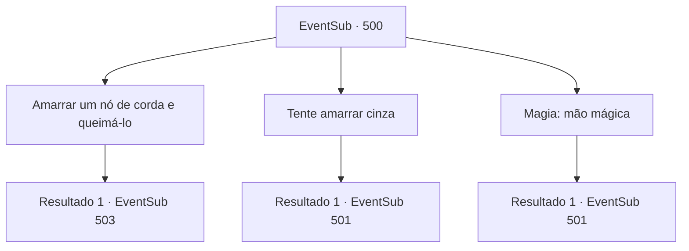

# Eventos secundários · 500

[Índice da tabela](index.md) · [Índice geral](../index.md)

ID: `pt:EventSub:500` · Fonte: `EventSub4` · Versão: 1.2.47.

Mapeamento estático dos arquivos; a disponibilidade e a execução dependem do estado da run.

## Texto do evento

*Sem texto no arquivo.*

## Dados de entrada

```json
{
  "id": 500,
  "grade": 1,
  "subEvent": "",
  "required": ""
}
```

## Mapa das escolhas



## Escolhas e resultados

### Escolha 1

Amarrar um nó de corda e queimá-lo

Requisitos e outros campos da escolha:

```json
{
  "required": "1_14_15"
}
```

#### Resultado 1.1

Você pega uma corda que está no chão.  Você a amarra em um nó e então a queima com a ajuda de Ternach.  

 "Oh...! Este é um verdadeiro nó feito de cinzas!"

  Ternach te abraça e acaricia sua cabeça.  Ternach olha para você com olhos brilhantes e continua.  

 "Se vocês conseguirem fazer isso, vocês passarão no teste do meu pai! Vamos lá!"


Continuação registrada: [Evento 503](0503.md) na mesma tabela.

```json
{
  "required": "",
  "chance": "1",
  "nextEvent": 503,
  "type": 2,
  "reward": ""
}
```

### Escolha 2

Tente amarrar cinza

Requisitos e outros campos da escolha:

```json
{
  "required": ""
}
```

#### Resultado 2.1

Você tem tentado amarrar a cinza, mas não é possível. Ternach suspira, observando a cinza escapar entre seus dedos. Então, Sartha grita. 

 "Você disse que precisa fazer um nó com cinzas? Eu sei a resposta! Eu juro!"

 Ternach rosna para ela. 

 "Hmm... O que você está fazendo?"

 No entanto, Sartha grita novamente. 

 "Se você prometer me deixar ir, eu vou resolver o problema."


Continuação registrada: [Evento 501](0501.md) na mesma tabela.

```json
{
  "required": "",
  "chance": "1",
  "nextEvent": 501,
  "type": 2,
  "reward": ""
}
```

### Escolha 3

Magia: mão mágica

Requisitos e outros campos da escolha:

```json
{
  "required": "20_0_1"
}
```

#### Resultado 3.1

Você tenta amarrar as cinzas usando magia, mas não é possível. Então, Sartha grita. 

 "Você disse que precisa fazer um nó com cinzas? Eu sei a resposta! Eu juro!"

 Ternach rosna para ela. 

 "Hmm... O que você está fazendo?"

 No entanto, Sartha grita novamente. 

 "Se você prometer me deixar ir, eu vou resolver o problema."


Continuação registrada: [Evento 501](0501.md) na mesma tabela.

```json
{
  "required": "",
  "chance": "1",
  "nextEvent": 501,
  "type": 2,
  "reward": ""
}
```

## Referências que chegam a este evento

- [Evento 498 · escolha 1 · resultado 1](0498.md#escolha-1)
- [Evento 498 · escolha 2 · resultado 1](0498.md#escolha-2)
- [Evento 498 · escolha 2 · resultado 2](0498.md#escolha-2)
- [Evento 498 · escolha 3 · resultado 1](0498.md#escolha-3)
- [Evento 499 · escolha 2 · resultado 1](0499.md#escolha-2)
