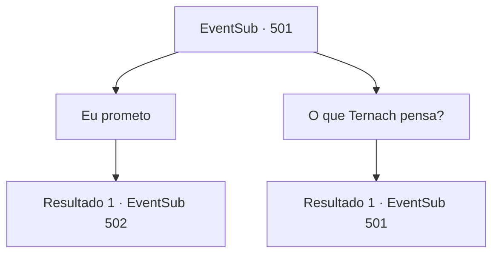

# Eventos secundários · 501

[Índice da tabela](index.md) · [Índice geral](../index.md)

ID: `pt:EventSub:501` · Fonte: `EventSub4` · Versão: 1.2.47.

Mapeamento estático dos arquivos; a disponibilidade e a execução dependem do estado da run.

## Texto do evento

*Sem texto no arquivo.*

## Dados de entrada

```json
{
  "id": 501,
  "grade": 1,
  "subEvent": "",
  "required": ""
}
```

## Mapa das escolhas



## Escolhas e resultados

### Escolha 1

Eu prometo

Requisitos e outros campos da escolha:

```json
{
  "required": ""
}
```

#### Resultado 1.1

Você diz a Sartha que se ela resolver um problema, você promete tirá-la daqui. 

 "Então, antes de mais nada, por favor me desamarre."

 Quando Ternach solta Sartha, ela imediatamente pega a corda caída e dá um nó. Ela coloca na caixa e acende fogo nela. 

 "Oh...! É um nó feito de cinzas!"

 Ternach olha para você com olhos brilhantes e continua. 

 "Se vocês conseguirem fazer isso, vocês passarão no teste do meu pai! Vamos lá!"

 Assim que Ternach termina de falar, Sartha continua. 

 "Espera, me ajude a escapar como você prometeu. Estamos no meio do Grande Deserto e eu não sei como voltar. Me leve para Antitikarr."


Continuação registrada: [Evento 502](0502.md) na mesma tabela.

```json
{
  "required": "",
  "chance": "1",
  "nextEvent": 502,
  "type": 2,
  "reward": ""
}
```

### Escolha 2

O que Ternach pensa?

Requisitos e outros campos da escolha:

```json
{
  "required": "5_459_0"
}
```

#### Resultado 2.1

Você olha para Ternach. Com um encolher de ombros, Ternach responde a você. 

 "Ah, estou bem. Não seria melhor resolver o problema da maneira que for necessário?"

 Então Ternach se aproxima de você e sussurra em seu ouvido. 

 "Mesmo que ela resolva o problema, se fosse vocês, não a deixaria ir."

 Afastando-se do seu ouvido, Ternach sorri maliciosamente.

Continuação registrada: [Evento 501](0501.md) na mesma tabela.

```json
{
  "required": "",
  "chance": "1",
  "nextEvent": 501,
  "type": 2,
  "reward": "5_459_1"
}
```

## Referências que chegam a este evento

- [Evento 499 · escolha 1 · resultado 1](0499.md#escolha-1)
- [Evento 500 · escolha 2 · resultado 1](0500.md#escolha-2)
- [Evento 500 · escolha 3 · resultado 1](0500.md#escolha-3)
- [Evento 501 · escolha 2 · resultado 1](0501.md#escolha-2)
