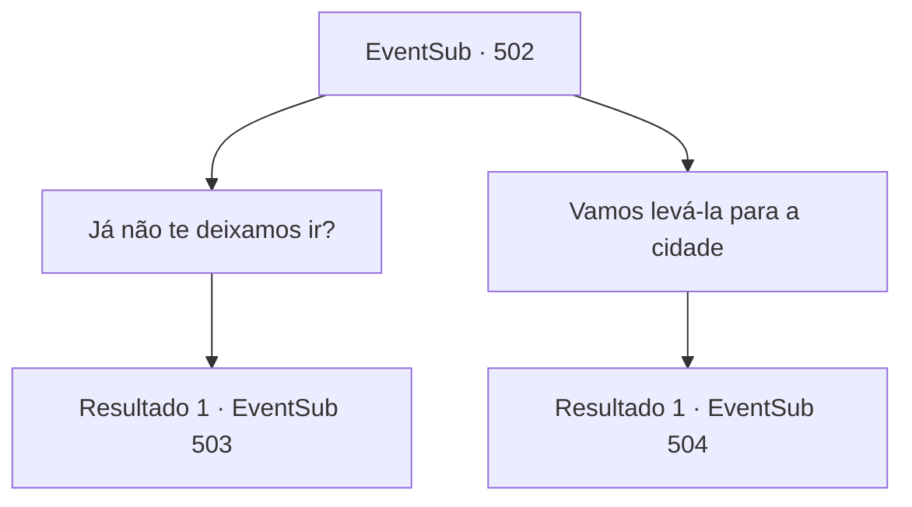

# Eventos secundários · 502

[Índice da tabela](index.md) · [Índice geral](../index.md)

ID: `pt:EventSub:502` · Fonte: `EventSub4` · Versão: 1.2.47.

Mapeamento estático dos arquivos; a disponibilidade e a execução dependem do estado da run.

## Texto do evento

*Sem texto no arquivo.*

## Dados de entrada

```json
{
  "id": 502,
  "grade": 1,
  "subEvent": "",
  "required": ""
}
```

## Mapa das escolhas



## Escolhas e resultados

### Escolha 1

Já não te deixamos ir?

Requisitos e outros campos da escolha:

```json
{
  "required": ""
}
```

#### Resultado 1.1


 "Oh... Não, isso não conta como me resgatar de verdade. Como posso atravessar o deserto e chegar até a cidade com um corpo tão fraco? Eu nem sei onde estou...!"

 Sartha está chateada, mas você ignora o seu choro. Ternach dá tapinhas no ombro dela e responde. 

 "Tchau, vocês podem ir agora."

 Então Ternach se aproxima de você. 

 "Vamos. Para o meu pai."


Continuação registrada: [Evento 503](0503.md) na mesma tabela.

```json
{
  "required": "",
  "chance": "1",
  "nextEvent": 503,
  "type": 2,
  "reward": ""
}
```

### Escolha 2

Vamos levá-la para a cidade

Requisitos e outros campos da escolha:

```json
{
  "required": ""
}
```

#### Resultado 2.1

Você pede a Ternach para fazer o que Sartha exige. Ternach faz uma cara emburrada. 

 "Eu não sei se temos que fazer isso..."

 Apesar de resmungar, Ternach retorna à sua forma original e coloca você e Sartha em suas costas. Vocês seguem direto para Antitikarr. 

 "Obrigado. Vou te recompensar."

 Quando vocês chegam em Antitikarr, Sartha promete te recompensar e se despede. As pessoas ficam chocadas com a aparição repentina do dragão, mas Ternach parece não se importar muito. Sartha desaparece na multidão de pessoas assustadas. Ternach a observa partir sem dizer uma palavra.

Continuação registrada: [Evento 504](0504.md) na mesma tabela.

```json
{
  "required": "",
  "chance": "1",
  "nextEvent": 504,
  "type": 2,
  "reward": ""
}
```

## Referências que chegam a este evento

- [Evento 501 · escolha 1 · resultado 1](0501.md#escolha-1)
