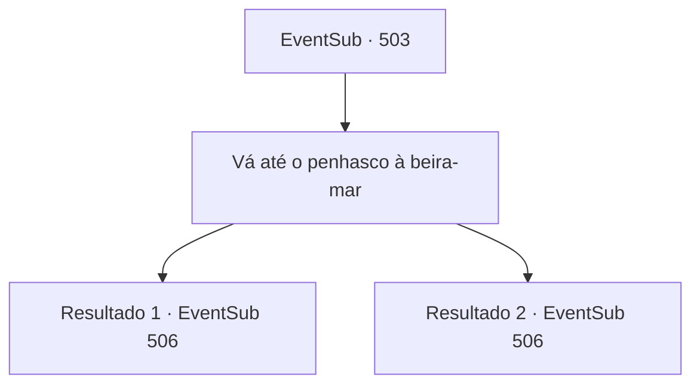

# Eventos secundários · 503

[Índice da tabela](index.md) · [Índice geral](../index.md)

ID: `pt:EventSub:503` · Fonte: `EventSub4` · Versão: 1.2.47.

Mapeamento estático dos arquivos; a disponibilidade e a execução dependem do estado da run.

## Texto do evento

*Sem texto no arquivo.*

## Dados de entrada

```json
{
  "id": 503,
  "grade": 1,
  "subEvent": "",
  "required": ""
}
```

## Mapa das escolhas



## Escolhas e resultados

### Escolha 1

Vá até o penhasco à beira-mar

Requisitos e outros campos da escolha:

```json
{
  "required": ""
}
```

#### Resultado 1.1

Você e Ternach voltam para a caverna na falésia perto da praia. Lá, você encontra novamente o pai de Ternach. O gigante dragão azul olha para você e pergunta. 

 "Vocês já resolveram o enigma?"

 Você entrega a ele a caixa. Ele abre a caixa e seus olhos se abrem de surpresa. 

 "Uau... Isso mesmo. Um nó de cinzas. Você é esperto."

 Ele pega a caixa e sorri satisfeito. Ele fala com Ternach na língua dos dragões. 

 "@#$#%!"

 Os dois dragões conversam entre si. Após uma longa conversa entre eles, Amunak se vira para você. 

 "Cortejando meu filho. Eu te dou minha permissão. Faça o seu melhor para fazer Ternach feliz."

 Amunak acena para você sair com o braço. Então você sai da caverna com Ternach. 

 "Legal. Papai reconhece você. É um pouco estranho chamar isso de celebração... mas vamos voar juntos?"


Continuação registrada: [Evento 506](0506.md) na mesma tabela.

```json
{
  "required": "2_7_14",
  "chance": "1",
  "nextEvent": 506,
  "type": 2,
  "reward": ""
}
```

#### Resultado 1.2

Você e Ternach voltam para a caverna na falésia perto da praia. Lá, você encontra novamente o pai de Ternach. O gigante dragão azul olha para você e pergunta. 

 "Vocês já resolveram o enigma?"

 Você entrega a ele a caixa. Ele abre a caixa e seus olhos se abrem de surpresa. 

 "Uau... Isso mesmo. Um nó de cinzas. Você é esperto."

 Ele pega a caixa e sorri satisfeito. Ele fala com Ternach na língua dos dragões. 

 "Vem aqui."

 Os dois dragões conversam entre si. O pai de Ternach pergunta a Ternach que tipo de pessoa você é. Ternach diz a ele que você é forte e sábio. Depois de uma longa conversa entre eles, Amunak se vira para você. 

 "Cortejando meu filho. Eu te dou minha permissão. Faça o seu melhor para fazer Ternach feliz."

 Amunak acena para você sair com o braço. Então você sai da caverna com Ternach. 

 "Legal. Papai reconhece você. É um pouco estranho chamar isso de celebração... mas vamos voar juntos?"


Continuação registrada: [Evento 506](0506.md) na mesma tabela.

```json
{
  "required": "1_7_14",
  "chance": "1",
  "nextEvent": 506,
  "type": 2,
  "reward": ""
}
```

## Referências que chegam a este evento

- [Evento 500 · escolha 1 · resultado 1](0500.md#escolha-1)
- [Evento 502 · escolha 1 · resultado 1](0502.md#escolha-1)
